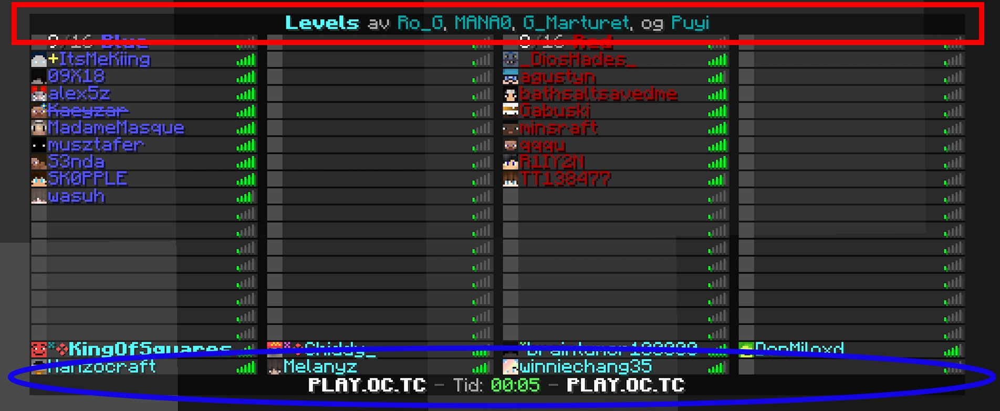

Adventure solo permite cambiar el encabezado (encima de los jugadores) y el pie (debajo de los jugadores) de la lista de jugadores.



**Uso**

En cualquier `Audience`, usa `Audience.sendPlayerListHeader(Component)`, `Audience.sendPlayerListFooter(Component)`
y/o `Audience.sendPlayerListHeaderAndFooter(Component, Component)`.

El hecho de que enviar solo el encabezado o el pie conserve el otro elemento existente depende de la plataforma
que uses. Lo más probable es que los servidores permitan conservarlos al enviarlos por separado, mientras que los proxies
probablemente solo permitan enviar ambos a la vez.

**Ejemplos**

```java
public void onPlayerJoin(final Audience player) {
  final Component header = Component.text("Mi servidor genial", NamedTextColor.BLUE);
  final Component footer = Component.text("Hoy es hoy");
  player.sendPlayerListHeaderAndFooter(header, footer);
}
```

Según la plataforma, el siguiente ejemplo también podría mostrar un encabezado existente.

```java
public void onDayChange(final Audience server) {
  final Component footer = Component.text("Mañana será mañana");
  server.sendPlayerListFooter(footer);
}
```
