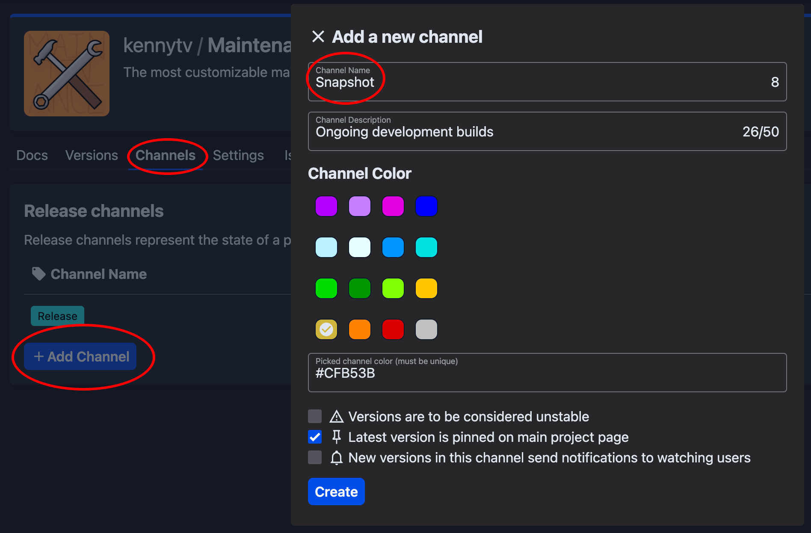
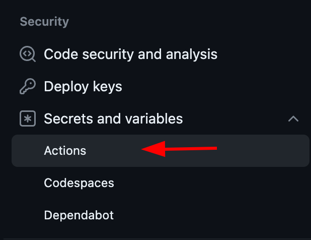

Si quieres publicar automáticamente tu plugin en [Hangar](https://hangar.papermc.io/) al enviar cambios, puedes usar
nuestro [plugin de Gradle](https://github.com/HangarMC/hangar-publish-plugin).

Después de añadir la configuración necesaria de `hangarPublish`, puedes publicarlo manualmente ejecutando
`./gradlew build publishPluginPublicationToHangar`, o configurar GitHub Actions para publicar una versión automáticamente con
cada confirmación.

## Requisitos previos

### Gradle

Tu proyecto de plugin debe usar Gradle como herramienta de compilación.

:::tip

Si usas
Maven, [cambiar a Gradle es sencillo](https://docs.gradle.org/current/userguide/migrating_from_maven.html) y, en
general, se recomienda por su mayor capacidad de configuración y compatibilidad con otros plugins, por ejemplo,
al [compilar contra un servidor de Minecraft sin ofuscar](/es/paper/dev/userdev).

Los ejemplos proporcionados usan Kotlin DSL, pero también puedes hacer lo mismo con Groovy. Los conversores en línea (incluso ChatGPT)
pueden convertir el código de ejemplo.

:::

### Crear el canal de publicación `Snapshot`

El script de compilación siguiente publicará las compilaciones que no sean de lanzamiento en el canal `Snapshot`. Primero debes crear este canal en
la página de canales de tu proyecto de Hangar.



### Añadir el secreto del repositorio `HANGAR_API_TOKEN`

Primero, debes crear un token de API de Hangar. Ve a la configuración de Hangar desde el menú desplegable del perfil y haz clic en "Api keys" a la izquierda. Luego, marca
el permiso `create_version`, asigna un nombre a la clave y créala. **En la parte superior** aparecerá tu token secreto de API.
**No lo compartas con nadie**; lo necesitarás en el siguiente paso.

El flujo de trabajo de GitHub Actions proporcionado usa un secreto del repositorio para almacenar tu clave de API de Hangar. Ve a la configuración de tu proyecto de GitHub,
haz clic en "Actions" en la pestaña Security y luego en el botón "New repository secret". Asigna al
secreto el nombre `HANGAR_API_TOKEN` y pega en el campo Secret el token de API de Hangar del paso anterior.



## Archivos del proyecto

Los siguientes archivos son ejemplos sencillos que requieren pocos cambios manuales para poder usarlos, aunque puedes adaptarlos
según tus necesidades. Revisa los comentarios y, en especial, los TODO para saber qué debes
cambiar.

### `gradle.properties`

Si aún no existe, crea un archivo `gradle.properties` en el directorio raíz del proyecto. Allí defines las
versiones de las plataformas con las que es compatible tu plugin. Simplemente elimina las plataformas que no necesites y añade las versiones
correctas.

Hangar permite intervalos de versiones (como `1.19-1.20.2`) y comodines (como `1.20.x`).

```properties
# Especifica las versiones de la plataforma para Paper y Velocity.
# Hangar también permite intervalos de versiones (como 1.19-1.20.2) y comodines (como 1.20.x).
# TODO: Elimina las plataformas que no necesites y pon las versiones correctas.
paperVersion=1.12.2, 1.16.5, 1.19-1.20.2
velocityVersion=3.2
waterfallVersion=1.20
```

### `build.gradle.kts`

En el bloque de plugins del script de compilación `build.gradle.kts`, añade el plugin de publicación:

```kotlin title="build.gradle.kts"
plugins {
    id("io.papermc.hangar-publish-plugin") version "0.1.2"
}
```

Después solo tienes que añadir el bloque de configuración `hangarPublish` y asegurarte de hacer lo siguiente:

- Si tu plugin no es un plugin de Paper o también es compatible con Velocity/Waterfall, copia el bloque register con una plataforma diferente
  y cambia la propiedad usada en lugar de `paperVersion` (tal como se declara en el archivo `gradle.properties`).
- Introduce el espacio de nombres correcto del proyecto.
- Añade las dependencias del plugin, si las hay.
- Si usas el archivo de Actions siguiente, debes configurar el secreto del repositorio `HANGAR_API_TOKEN`; de lo contrario, añade la
  clave de API de otra forma.

```kotlin
import io.papermc.hangarpublishplugin.model.Platforms

// ...

hangarPublish {
    publications.register("plugin") {
        version.set(project.version as String)
        channel.set("Snapshot") // Estamos usando el canal "Snapshot"
        // TODO: Edita el nombre del proyecto para que coincida con tu proyecto de Hangar
        id.set("hangar-project")
        apiKey.set(System.getenv("HANGAR_API_TOKEN"))
        platforms {
            // TODO: Usa la(s) plataforma(s) correcta(s) para tu plugin
            register(Platforms.PAPER) {
                // TODO: Si usas ShadowJar, sustituye las líneas del JAR por la tarea adecuada:
                //   jar.set(tasks.shadowJar.flatMap { it.archiveFile })
                // Establece el archivo JAR a cargar
                jar.set(tasks.jar.flatMap { it.archiveFile })

                // Establece las versiones de la plataforma desde el archivo gradle.properties
                val versions: List<String> = (property("paperVersion") as String)
                        .split(",")
                        .map { it.trim() }
                platformVersions.set(versions)

                // TODO: Configura las dependencias de tu plugin, si las hay
                dependencies {
                    // Ejemplo de una dependencia que se encuentra en Hangar
                    hangar("Maintenance") {
                        required.set(false)
                    }
                    // Ejemplo de una dependencia externa
                    url("Debuggery", "https://github.com/PaperMC/Debuggery") {
                        required.set(true)
                    }
                }
            }
        }
    }
}
```

## Flujo de trabajo de GitHub Actions

No es imprescindible publicar mediante GitHub Actions, pero es una forma sencilla de hacerlo. Si quieres usarlo, crea
un archivo `publish.yml` en el directorio `.github/workflows` de la raíz del proyecto y asegúrate de
[añadir el secreto del repositorio](#añadir-el-secreto-del-repositorio-hangar_api_token).

Puedes añadir o quitar ramas que se publicarán editando la sección `branches`.

```yaml
name: Publish to Hangar
on:
  push:
    branches:
      # Añade cualquier rama adicional desde la que quieras publicar automáticamente
      - main # Suponiendo que tu rama principal se llama 'main'

jobs:
  publish:
    # TODO: Opcional; asegúrate de que la tarea solo se ejecute al hacer push a tu repositorio y no falle en forks. Descomenta la línea de abajo y escribe el propietario del repositorio entre comillas
    # if: github.repository_owner == '<YOUR USER/ORG NAME>'
    runs-on: ubuntu-latest
    steps:
      - name: Checkout Repository
        uses: actions/checkout@v7
      - name: Set up JDK 25
        uses: actions/setup-java@v5
        with:
          distribution: 'temurin'
          java-version: 25
      - name: Setup Gradle
        uses: gradle/actions/setup-gradle@v6
      - name: Publish
        env:
          # Asegúrate de haber añadido un secreto del repositorio en la configuración del repositorio
          HANGAR_API_TOKEN: ${{ secrets.HANGAR_API_TOKEN }}
        run: ./gradlew build publishPluginPublicationToHangar --stacktrace
```

## Opcional: gestionar varios canales y un registro de cambios automático

Con el siguiente código, cualquier versión que contenga un guion (`-`) se publicará en el canal `Snapshot`
(que debes crear en Hangar), y las demás, en el canal `Release`.
Puedes cambiarlo por cualquier otro canal editando la línea `channel.set(...)`.
Por ejemplo, también podrías dividir las compilaciones según la rama actual y usar compilaciones `Alpha`.

:::caution

Asegúrate de no publicar nunca compilaciones de desarrollo en curso en el canal `Release`.

:::

```kotlin
import java.io.ByteArrayOutputStream

// ...

// Helper methods
fun executeGitCommand(vararg command: String): String {
    val byteOut = ByteArrayOutputStream()
    exec {
        commandLine = listOf("git", *command)
        standardOutput = byteOut
    }
    return byteOut.toString(Charsets.UTF_8.name()).trim()
}

fun latestCommitMessage(): String {
    return executeGitCommand("log", "-1", "--pretty=%B")
}

val versionString: String = version as String
val isRelease: Boolean = !versionString.contains('-')

val suffixedVersion: String = if (isRelease) {
    versionString
} else {
    // Dale a la versión un nombre único usando el número de ejecución de GitHub Actions
    versionString + "+" + System.getenv("GITHUB_RUN_NUMBER")
}

// Usa la descripción del commit para el registro de cambios
val changelogContent: String = latestCommitMessage()

// Si quieres publicar releases con sus changelogs adecuados de forma manual, simplemente añade una instrucción if con la variable `isRelease` aquí.
hangarPublish {
    publications.register("plugin") {
        version.set(suffixedVersion)
        channel.set(if (isRelease) "Release" else "Snapshot")
        changelog.set(changelogContent)
        // ... (ver arriba)
    }
}
```

## Opcional: actualizar la página del recurso

Al publicar una versión nueva, quizá quieras actualizar la página del recurso (por ejemplo, la página de inicio del plugin) con contenido nuevo del repositorio del plugin.

En este ejemplo usamos un archivo README, pero puedes usar cualquier texto, siempre que tenga formato Markdown.

```kotlin
val pageContent = project.file("README.md").readText()

hangarPublish {
    publications.register("plugin") {
        // ... (ver arriba)
        pages.resourcePage(pageContent)
    }
}
```

Puedes ejecutar la tarea `syncPluginPublicationMainResourcePagePageToHangar` para actualizar la página del recurso en Hangar.
Esto no publicará una nueva versión; solo actualizará el contenido de la página en Hangar.

Si usas un flujo de trabajo de GitHub Actions, también deberías añadir la invocación de la tarea al paso `Publish` del flujo:
```yaml
- name: Publish
  # ...
  run: ./gradlew build publishPluginPublicationToHangar syncPluginPublicationMainResourcePagePageToHangar --stacktrace
```
