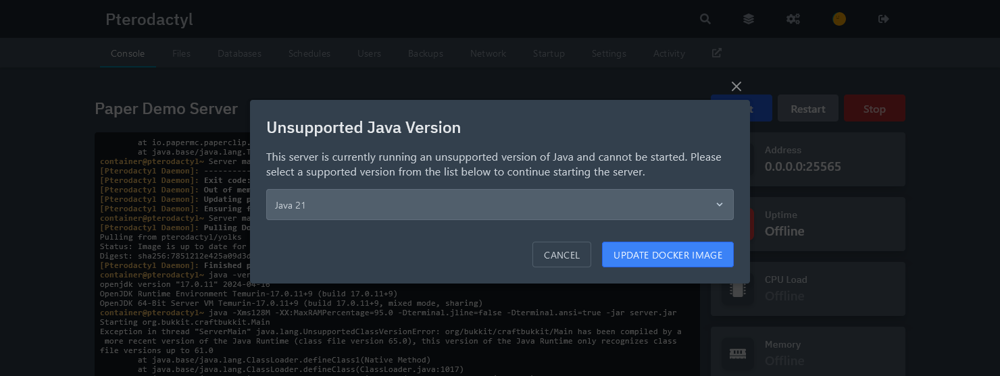
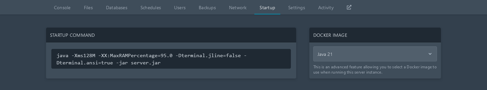
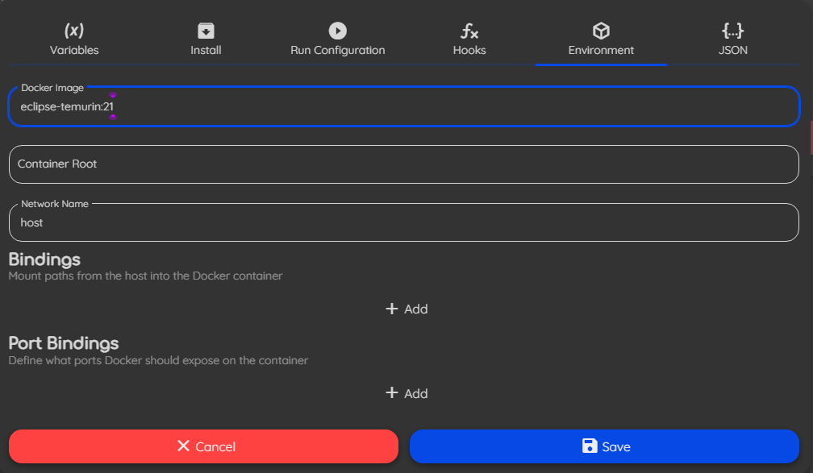

Instalar Java es un primer paso fundamental para usar o desarrollar plugins para Paper y Velocity.
Esta guía explica los pasos de instalación recomendados para la mayoría de las principales
plataformas.

:::caution[¡No uses las variantes headless de Java!]

Hay variantes `headless` de Java cuyo paquete suele tener el sufijo `-headless`.
Estas variantes no incluyen dependencias necesarias para Paper. Por eso, no se recomienda usarlas.

:::

:::tip

Esta guía se centra en la distribución OpenJDK Corretto de Amazon porque ofrece la mejor
experiencia de instalación en la mayoría de las plataformas. Sin embargo, Corretto no es el único proveedor de OpenJDK
disponible. Hay muchas alternativas, como [Eclipse Adoptium](https://adoptium.net/),
[Microsoft](https://www.microsoft.com/openjdk) y
[Azul Zulu](https://www.azul.com/downloads/?package=jdk). Ten en cuenta que no recomendamos el JDK distribuido por Oracle, aunque sea funcionalmente idéntico,
debido a que su instalador es muy poco amigable y a sus anteriores condiciones de licencia restrictivas.

:::

## Linux

### Ubuntu/Debian

Instalar Java 25 en distribuciones Linux basadas en Debian es muy sencillo. Primero, asegúrate de que el sistema tenga
todas las herramientas necesarias para instalar Java correctamente.

```bash
sudo apt-get update
sudo apt-get install ca-certificates apt-transport-https gnupg wget
```

Después, importa la clave pública y el repositorio apt de Amazon Corretto.

```bash
wget -O - https://apt.corretto.aws/corretto.key | sudo gpg --dearmor -o /usr/share/keyrings/corretto-keyring.gpg && \
echo "deb [signed-by=/usr/share/keyrings/corretto-keyring.gpg] https://apt.corretto.aws stable main" | sudo tee /etc/apt/sources.list.d/corretto.list
```

Luego, instala Java 25 y otras dependencias con el siguiente comando:

```bash
sudo apt-get update
sudo apt-get install -y java-25-amazon-corretto-jdk libxi6 libxtst6 libxrender1
```

Continúa con [verificar la instalación](#verificar-la-instalación).

### Basado en RPM

Para instalar Java 25 en CentOS, RHEL, Fedora, openSUSE, SLES u otra distribución Linux basada en RPM,
ejecuta los siguientes comandos según el gestor de paquetes. Cuando termines,
continúa con [verificar la instalación](#verificar-la-instalación).

#### DNF

DNF se usa en Fedora, CentOS/RHEL 7 y distribuciones relacionadas.

```bash
sudo rpm --import https://yum.corretto.aws/corretto.key
sudo curl -Lo /etc/yum.repos.d/corretto.repo https://yum.corretto.aws/corretto.repo
sudo dnf -y install java-25-amazon-corretto-devel
```

#### Zypper

Zypper se usa en openSUSE, SLES y distribuciones relacionadas.

```bash
sudo zypper addrepo https://yum.corretto.aws/corretto.repo
sudo zypper refresh
sudo zypper install java-25-amazon-corretto-devel
```

#### YUM

YUM se usa en versiones antiguas de CentOS/RHEL y en versiones muy antiguas de Fedora.

```bash
sudo rpm --import https://yum.corretto.aws/corretto.key
sudo curl -Lo /etc/yum.repos.d/corretto.repo https://yum.corretto.aws/corretto.repo
sudo yum -y install java-25-amazon-corretto-devel
```

## Windows 10 y 11

En Windows 10 u 11, instalar Java es igual que instalar cualquier otro programa. Descarga
el instalador de Amazon Corretto desde
[su sitio web](https://corretto.aws/downloads/latest/amazon-corretto-25-x64-windows-jdk.msi).

Después de ejecutar el instalador, puedes hacer clic en «siguiente» durante todo el proceso. No se instalarán
programas no deseados ni barras de herramientas, y todas las funciones necesarias vienen habilitadas de forma predeterminada.

Ahora, abre una línea de comandos y continúa con [verificar la instalación](#verificar-la-instalación).

## macOS/OS X

En macOS, la mejor forma de gestionar las instalaciones de Java es mediante una herramienta llamada
[Homebrew](https://brew.sh). Sigue las instrucciones de su página de inicio para instalarla. Después, ejecuta el siguiente comando en la
terminal:

```bash
brew install openjdk@25
```

Cuando termine este comando, continúa con [verificar la instalación](#verificar-la-instalación).

## Pterodactyl

:::note

En versiones de Pterodactyl anteriores a `1.2.0`, se necesita una cuenta de administrador para cambiar la versión de Java.
Estas instrucciones no serán aplicables.

:::

Si iniciaste un servidor Paper con una versión de Java incorrecta, Pterodactyl te pedirá automáticamente
que la actualices de esta forma:



Si no aparece este aviso, puedes cambiar la versión de Java manualmente. Ve a la pestaña
"Inicio" del servidor y selecciona `Java 25` en el menú desplegable "Imagen de Docker",
como se muestra en la imagen siguiente.



:::note

Si no ves `Java 25` en el menú desplegable, se necesita una cuenta de administrador para actualizar el egg de Paper.

:::

## Pufferpanel (Docker)

:::note

Necesitarás permisos de **Admin** en el panel para cambiar la versión de Java.

:::

En el servidor cuya versión de Java quieras cambiar, ve a la pestaña **Admin** y abre
**Editar la definición del servidor**. En la pestaña **Entorno**, el campo **Imagen de Docker** te permite
editar la imagen de Docker utilizada.



En este caso, basta con reemplazar la versión (el número después de ":") por `25`.
Puedes encontrar imágenes de Docker alternativas del JDK en
[Docker Hub](https://hub.docker.com/search?badges=official).

## Verificar la instalación

:::note

Esta sección no se aplica al usar Pterodactyl o Pufferpanel.

:::

Ahora que instalaste Java 25, ejecuta este comando en la terminal para comprobar que el proceso se
completó correctamente.

```bash
java -version
```

El resultado debería parecerse al siguiente. Comprueba que empiece por
`openjdk 25` y que la última línea incluya `64-Bit`. Si el resultado es parecido a
`java: command not found`, prueba a abrir una sesión nueva de la terminal.

```
openjdk version "25" 2025-09-16
OpenJDK Runtime Environment (build 25+36-3489)
OpenJDK 64-Bit Server VM (build 25+36-3489, mixed mode, sharing)
```

Si la instalación falla, no dudes en pedir ayuda en el canal `#paper-help` de nuestro
[Discord](https://discord.gg/papermc).
