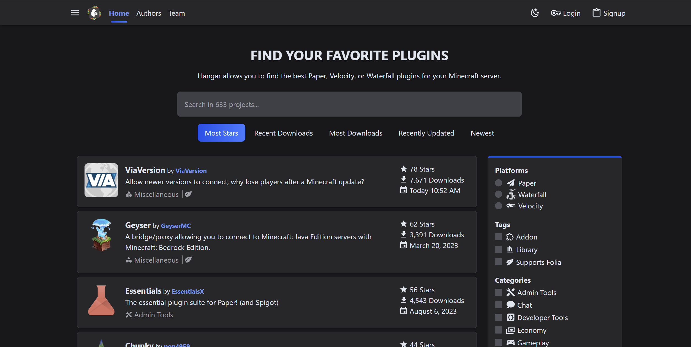

Ahora que tu servidor está en funcionamiento, hay algunas cosas que deberías hacer para asegurarte de que funcione sin problemas.

## Configuración

Una de las primeras cosas que deberías hacer es asegurarte de que el servidor esté configurado según tus preferencias.
Paper ofrece muchas opciones de configuración que puedes adaptar a tus necesidades. En la guía de
[configuración](/es/paper/reference/configuration) explicamos dónde encontrar estos ajustes.

## Plugins

Una de las principales razones para usar Paper es aprovechar los numerosos plugins que utilizan nuestra
amplia API. Tenemos nuestro propio repositorio de plugins, [Hangar](https://hangar.papermc.io/), donde puedes
encontrar muchos plugins para tu servidor. También tenemos una guía sobre cómo instalarlos
[aquí](/es/paper/adding-plugins).

## Seguridad

### Lista de permitidos

Si quieres restringir quién puede entrar en tu servidor, puedes usar la lista de permitidos. Esta función te permite
indicar quién puede entrar e impide el acceso a cualquier otra persona. Puedes administrar la lista desde
la consola del servidor o editando el archivo `whitelist.json` en el directorio del servidor.

### Permisos

Los permisos permiten controlar lo que los jugadores pueden y no pueden hacer en tu servidor. Puedes usarlos
para restringir quién puede ejecutar determinados comandos o acceder a ciertas zonas. Es habitual que los plugins
usen permisos para controlar quién puede utilizar sus funciones. Puedes administrar los permisos que se conceden
a los jugadores con plugins como [LuckPerms](https://luckperms.net/).

## Copias de seguridad

Es importante conservar copias de seguridad del servidor. Si algo sale mal, podrás restaurarlo a un
estado anterior. Explicamos cómo hacerlo en la guía de [actualización](/es/paper/updating).

## Optimización

Paper viene optimizado para ofrecer un buen rendimiento. Aun así, puedes hacer muchas cosas para optimizarlo
aún más. Una de las más habituales es asegurarte de que el servidor se ejecute con los indicadores de inicio
adecuados. Tenemos una herramienta que genera automáticamente un script de inicio con los indicadores correctos.
Puedes encontrarla
[aquí](/es/misc/tools/start-script-gen). Además, una guía como [esta](https://paper-chan.moe/paper-optimization/)
te ayudará a optimizar aún más tu servidor.

## Hacer público tu servidor

Si quieres hacer público tu servidor, tendrás que configurar el reenvío de puertos. Esto permite que personas
ajenas a tu red se conecten al servidor. [NordVPN](https://nordvpn.com/blog/open-ports-on-router/) ofrece una guía
que explica qué es el reenvío de puertos y cómo configurarlo para tu servidor Paper.

## Solución de problemas

Si tienes algún problema con el servidor, puedes seguir nuestra guía de [solución de problemas](/es/paper/basic-troubleshooting)
para diagnosticarlo y resolverlo. Si no consigues solucionarlo, puedes pedir ayuda en nuestro servidor de
[Discord](https://discord.gg/papermc).
