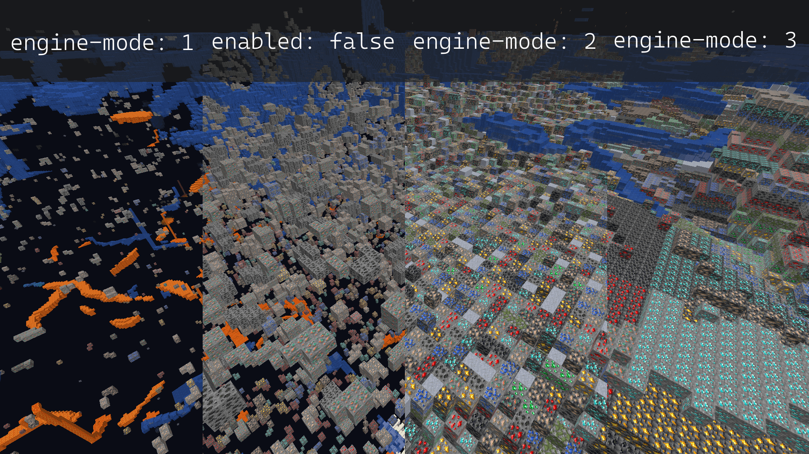
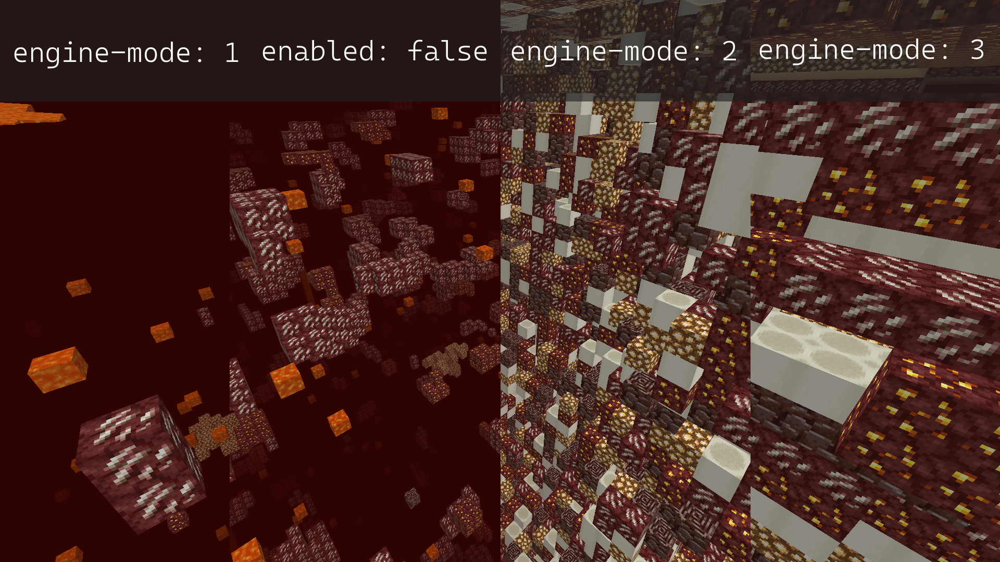

> Escrito y mantenido originalmente por [stonar96](https://github.com/stonar96).

Paper incluye Anti-Xray basado en ofuscación, con tres modos que se pueden configurar por mundo.

:::note[Configuración por mundo]

Si aún no conoces la configuración por mundo, dedica un momento a familiarizarte con la
[guía de configuración](/es/paper/reference/configuration).

:::

Esta guía explica paso a paso cómo configurar Anti-Xray. Para consultar la documentación de referencia,
visita la sección de Anti-Xray de la
[referencia de configuración por mundo](/es/paper/reference/world-configuration#anticheat_anti_xray).

Anti-Xray tiene tres modos. `engine-mode: 1` sustituye los bloques especificados en `hidden-blocks` por
otros bloques «falsos»: `stone` (`deepslate` si y < 0), `netherrack` o `end_stone`, según la
dimensión. En cambio, `engine-mode: 2` sustituye tanto los bloques de `hidden-blocks` como los de `replacement-blocks`
por bloques de `hidden-blocks` generados aleatoriamente. `engine-mode: 3` funciona de forma similar a `engine-mode: 2`, pero en vez de
aleatorizar cada bloque, aleatoriza el bloque de cada capa de un chunk.

Las imágenes siguientes[^1] muestran cómo se ve cada modo para un jugador que usa Xray con la configuración
recomendada, tanto en el Overworld como en el Nether.

[^1]:
    Diseño de la imagen por `Oberfail`, publicada originalmente en el
    [PaperMC Discord](https://discord.gg/papermc).

{/*

Seed: -7943468717341609647

# Overworld:
/tp @p -581.976 67.85076 -4924.106 47 36

# Nether:
/tp @p 789.437 117.38012 -319.064 -137.4 28
*/}




Especialmente en el cliente, `engine-mode: 1` requiere muchos menos recursos de cómputo, mientras que
`engine-mode: 2` puede impedir mejor el uso de Xray. Con `engine-mode: 1`, solo se ocultan los minerales completamente cubiertos
por bloques sólidos. No se ocultan los minerales expuestos al aire en cuevas ni al agua de un lago.
Con `engine-mode: 2`, los minerales falsos ocultan los bloques reales. Si añades `air` a
`hidden-blocks`, `engine-mode: 2` ocultará prácticamente todos los minerales, incluso los expuestos al aire. `engine-mode: 3` puede reducir aproximadamente a la mitad la carga de red al entrar y ayuda a comprimir los paquetes de chunks.

:::caution[Formas de eludir Anti-Xray]

**Ampliación del alcance**: Aunque Anti-Xray por sí solo impedirá que la mayoría de los usuarios usen Xray en tu
servidor, no es infalible en absoluto. Debido a la forma en que Anti-Xray está implementado (y debe implementarse),
en un servidor predeterminado es posible ampliar de forma considerable el alcance al que se pueden ver minerales reales.
Un plugin antitrampas competente puede mitigar esto; sin embargo, no se incluye de forma predeterminada.

**Inversión de la seed**: Otro vector de ataque es el carácter determinista de la generación de mundos de Minecraft.
Si el cliente consigue obtener la seed del mundo, puede conocer la ubicación real de
cada mineral generado y eludir por completo Anti-Xray. Se puede dificultar parcialmente esta inversión de la seed con la
[configuración `feature-seeds`](/es/paper/reference/world-configuration#feature_seeds), junto con
las opciones de seed de estructuras de `spigot.yml`. Ten en cuenta que no es una solución completa: el cliente
aún podría obtener la seed del mundo del servidor. También puede ser útil usar una seed distinta
para cada mundo.

**Minerales expuestos al aire**: En `engine-mode: 1`, `engine-mode: 2` y `engine-mode: 3`, el cliente puede
ver los minerales expuestos al aire. En `engine-mode: 2` y `engine-mode: 3`, esto se puede mitigar añadiendo `air` a
la lista `hidden-blocks`. Sin embargo, esto puede provocar problemas de rendimiento en el cliente (caídas de FPS) a
algunos jugadores.

:::

## Configuración recomendada

La configuración recomendada para `engine-mode: 1`, `engine-mode: 2` y `engine-mode: 3` es la siguiente:

:::tip[Espaciado]

¡YAML distingue los espacios en blanco! El ejemplo de configuración siguiente ya tiene el formato correcto. Para mantener
el formato y la sangría, usa el botón «copiar» situado en la esquina superior derecha de cada
ejemplo. Asegúrate especialmente de no insertar tabuladores por accidente. Comprueba las opciones del editor
para usar espacios en lugar de tabuladores en la sangría. Si el archivo de configuración ya contiene
otros cambios importantes, se recomienda hacer una copia de seguridad antes de editarlo.

:::

### `engine-mode: 1`

<details>
  <summary>Configuración predeterminada del mundo</summary>

Sustituye el bloque `anticheat.anti-xray` existente en `paper-world-defaults.yml` por el siguiente:

```yaml title="paper-world-defaults.yml"
anticheat:
  anti-xray:
    enabled: true
    engine-mode: 1
    hidden-blocks:
    # No hay forma de ocultar los cofres de las mazmorras, ya que están completamente rodeados de aire; los tesoros enterrados sí se ocultarán.
    - chest
    - coal_ore
    - deepslate_coal_ore
    - copper_ore
    - deepslate_copper_ore
    - raw_copper_block
    - diamond_ore
    - deepslate_diamond_ore
    - emerald_ore
    - deepslate_emerald_ore
    - gold_ore
    - deepslate_gold_ore
    - iron_ore
    - deepslate_iron_ore
    - raw_iron_block
    - lapis_ore
    - deepslate_lapis_ore
    - redstone_ore
    - deepslate_redstone_ore
    lava-obscures: false
    # Desde la versión 1.18, algunos minerales se generan a mucha más altura.
    # Ajusta el valor de max-block-height según lo necesites.
    # Puede serte útil consultar https://minecraft.wiki/w/Ore.
    max-block-height: 64
    # La lista replacement-blocks no se usa en engine-mode: 1. Cambiarla no tendrá efecto.
    replacement-blocks: []
    update-radius: 2
    use-permission: false
```

</details>

<details>
  <summary>Configuración del Nether</summary>

Copia y pega esto en el archivo `paper-world.yml` de la carpeta del mundo Nether. Consulta la
[guía de configuración](/es/paper/reference/configuration) para obtener más información.

```yml title="world/dimensions/minecraft/the_nether/paper-world.yml"
anticheat:
  anti-xray:
    enabled: true
    engine-mode: 1
    hidden-blocks:
    - ancient_debris
    - nether_gold_ore
    - nether_quartz_ore
    lava-obscures: false
    max-block-height: 128
    # La lista replacement-blocks no se usa en engine-mode: 1. Cambiarla no tendrá efecto.
    replacement-blocks: []
    update-radius: 2
    use-permission: false
```

</details>

<details>
  <summary>Configuración del End</summary>

Copia y pega esto en el archivo `paper-world.yml` de la carpeta del mundo End. Consulta la
[guía de configuración](/es/paper/reference/configuration) para obtener más información.

```yml title="world/dimensions/minecraft/the_end/paper-world.yml"
anticheat:
  anti-xray:
    enabled: false
```

</details>

### `engine-mode: 2`

<details>
  <summary>Configuración predeterminada del mundo</summary>

Sustituye el bloque `anticheat.anti-xray` existente en `paper-world-defaults.yml` por el siguiente:

```yaml title="paper-world-defaults.yml"
anticheat:
  anti-xray:
    enabled: true
    engine-mode: 2
    hidden-blocks:
    # Puedes añadir aire aquí para que se generen muchos agujeros.
    # Esto funciona bien contra quienes buscan cuevas, pero puede reducir los FPS del cliente de todos los jugadores.
    - air
    - copper_ore
    - deepslate_copper_ore
    - raw_copper_block
    - diamond_ore
    - deepslate_diamond_ore
    - gold_ore
    - deepslate_gold_ore
    - iron_ore
    - deepslate_iron_ore
    - raw_iron_block
    - lapis_ore
    - deepslate_lapis_ore
    - redstone_ore
    - deepslate_redstone_ore
    lava-obscures: false
    # Desde la versión 1.18, algunos minerales se generan a mucha más altura.
    # Ajusta el valor de max-block-height según lo necesites.
    # Puede serte útil consultar https://minecraft.wiki/w/Ore.
    max-block-height: 64
    replacement-blocks:
    # Chest es una entidad de bloque y no se puede añadir a hidden-blocks en engine-mode: 2.
    # Sin embargo, si aumentas max-block-height, añadir chest aquí ocultará los tesoros enterrados.
    - chest
    - amethyst_block
    - andesite
    - budding_amethyst
    - calcite
    - coal_ore
    - deepslate_coal_ore
    - deepslate
    - diorite
    - dirt
    - emerald_ore
    - deepslate_emerald_ore
    - granite
    - gravel
    - oak_planks
    - smooth_basalt
    - stone
    - tuff
    update-radius: 2
    use-permission: false
```

</details>

<details>
  <summary>Configuración del Nether</summary>

Copia y pega esto en el archivo `paper-world.yml` de la carpeta del mundo Nether. Consulta la
[guía de configuración](/es/paper/reference/configuration) para obtener más información.

```yml title="world/dimensions/minecraft/the_nether/paper-world.yml"
anticheat:
  anti-xray:
    enabled: true
    engine-mode: 2
    hidden-blocks:
    # Consulta la nota anterior sobre el aire y los posibles problemas de rendimiento del cliente.
    - air
    - ancient_debris
    - bone_block
    - glowstone
    - magma_block
    - nether_bricks
    - nether_gold_ore
    - nether_quartz_ore
    - polished_blackstone_bricks
    lava-obscures: false
    max-block-height: 128
    replacement-blocks:
    - basalt
    - blackstone
    - gravel
    - netherrack
    - soul_sand
    - soul_soil
    update-radius: 2
    use-permission: false

```

</details>

<details>
  <summary>Configuración del End</summary>

Copia y pega esto en el archivo `paper-world.yml` de la carpeta del mundo End. Consulta la
[guía de configuración](/es/paper/reference/configuration) para obtener más información.

```yml title="world/dimensions/minecraft/the_end/paper-world.yml"
anticheat:
  anti-xray:
    enabled: false
```
</details>


### `engine-mode: 3`

<details>
  <summary>Configuración predeterminada del mundo</summary>

Sustituye el bloque `anticheat.anti-xray` existente en `paper-world-defaults.yml` por el siguiente:

```yaml title="paper-world-defaults.yml"
anticheat:
  anti-xray:
    enabled: true
    engine-mode: 3
    hidden-blocks:
    # Puedes añadir aire aquí para que se generen muchos agujeros.
    # Esto funciona bien contra quienes buscan cuevas, pero puede reducir los FPS del cliente de todos los jugadores.
    - air
    - copper_ore
    - deepslate_copper_ore
    - raw_copper_block
    - diamond_ore
    - deepslate_diamond_ore
    - gold_ore
    - deepslate_gold_ore
    - iron_ore
    - deepslate_iron_ore
    - raw_iron_block
    - lapis_ore
    - deepslate_lapis_ore
    - redstone_ore
    - deepslate_redstone_ore
    lava-obscures: false
    # Desde la versión 1.18, algunos minerales se generan a mucha más altura.
    # Ajusta el valor de max-block-height según lo necesites.
    # Puede serte útil consultar https://minecraft.wiki/w/Ore.
    max-block-height: 64
    replacement-blocks:
    # Chest es una entidad de bloque y no se puede añadir a hidden-blocks en engine-mode: 2.
    # Sin embargo, si aumentas max-block-height, añadir chest aquí ocultará los tesoros enterrados.
    - chest
    - amethyst_block
    - andesite
    - budding_amethyst
    - calcite
    - coal_ore
    - deepslate_coal_ore
    - deepslate
    - diorite
    - dirt
    - emerald_ore
    - deepslate_emerald_ore
    - granite
    - gravel
    - oak_planks
    - smooth_basalt
    - stone
    - tuff
    update-radius: 2
    use-permission: false
```

</details>

<details>
  <summary>Configuración del Nether</summary>

Copia y pega esto en el archivo `paper-world.yml` de la carpeta del mundo Nether. Consulta la
[guía de configuración](/es/paper/reference/configuration) para obtener más información.

```yml title="world/dimensions/minecraft/the_nether/paper-world.yml"
anticheat:
  anti-xray:
    enabled: true
    engine-mode: 3
    hidden-blocks:
    # Consulta la nota anterior sobre el aire y los posibles problemas de rendimiento del cliente.
    - air
    - ancient_debris
    - bone_block
    - glowstone
    - magma_block
    - nether_bricks
    - nether_gold_ore
    - nether_quartz_ore
    - polished_blackstone_bricks
    lava-obscures: false
    max-block-height: 128
    replacement-blocks:
    - basalt
    - blackstone
    - gravel
    - netherrack
    - soul_sand
    - soul_soil
    update-radius: 2
    use-permission: false
```

</details>

<details>
  <summary>Configuración del End</summary>

Copia y pega esto en el archivo `paper-world.yml` de la carpeta del mundo End. Consulta la
[guía de configuración](/es/paper/reference/configuration) para obtener más información.

```yml title="world/dimensions/minecraft/the_end/paper-world.yml"
anticheat:
  anti-xray:
    enabled: false
```

</details>

## Preguntas frecuentes, errores comunes y asistencia

<details>
  <summary>Aún puedo ver algunos minerales o usar Xray</summary>

Como se describió anteriormente, hay varios motivos por los que quizá aún puedas ver algunos minerales aunque hayas
activado Anti-Xray:

* Los minerales están por encima del valor configurado en `max-block-height`.
* Anti-Xray no puede ocultar minerales expuestos al aire o a otros bloques transparentes (por ejemplo, en cuevas). En
  principio, esto también ocurre con `engine-mode: 2` y `engine-mode: 3`; sin embargo, normalmente los minerales falsos ocultan
  los bloques reales. Para ocultar también esos minerales expuestos se necesitan plugins adicionales.
* La opción `use-permission` está habilitada y tienes el permiso para eludir Anti-Xray (`paper.antixray.bypass`) o tienes
  estado de operador.
* Falta el tipo de bloque en las listas de bloques configuradas. Esto puede deberse a que se usa un
  archivo de configuración obsoleto.

</details>

<details>
  <summary>Añadí bloques falsos, pero Xray no los muestra</summary>

Si usas `engine-mode: 2` o `engine-mode: 3` y añadiste bloques falsos a la lista `hidden-blocks`, pero no puedes
verlos dentro del juego con Xray, puede deberse a lo siguiente:

* Los tipos de bloque añadidos son entidades de bloque. Anti-Xray puede ocultar (sustituir) entidades de bloque, como
  cofres, siempre que no estén expuestas al aire ni a otros bloques transparentes. Sin embargo, Anti-Xray
  no puede colocar entidades de bloque falsas en el chunk.
* El bloque está desactivado en el mod Xray de tu cliente o tu paquete de recursos Xray no lo muestra.

</details>

<details>
  <summary>No funciona por debajo de y = 0 ni en ciertos otros lugares</summary>

* Es probable que tu archivo de configuración esté obsoleto y que falten bloques importantes en la lista
  `replacement-blocks`, como `deepslate` o bloques específicos de biomas, como `basalt`. También
  podrías comprobar si la lista `hidden-blocks` incluye todos los minerales importantes y sus
  variantes de `deepslate`.
* Si no funciona por encima de cierta altura Y, comprueba el ajuste `max-block-height`.

</details>

<details>
  <summary>Sigue sin funcionar: más pasos para solucionar problemas</summary>

* Asegúrate de reiniciar siempre el servidor después de cambiar la configuración de Anti-Xray.
  Los cambios no se aplican automáticamente.
* No uses el comando `/reload`. Es necesario reiniciar el servidor para aplicar los cambios de configuración de Anti-Xray.
* Después de reiniciar el servidor, comprueba que la configuración se haya aplicado correctamente inspeccionando las
  secciones de configuración con timings o spark.

</details>

<details>
  <summary>¿Cómo y dónde puedo pedir ayuda si sigue sin funcionar?</summary>

Si los puntos anteriores no resuelven el problema o tienes más preguntas sobre
Anti-Xray, no dudes en consultarnos en el [Discord de PaperMC](https://discord.gg/papermc),
en el canal #paper-help. Procura describir el problema con el mayor detalle posible.
Decir «no funciona» no ayuda mucho a quienes prestan asistencia. Explica qué quieres conseguir,
qué has intentado, qué esperabas y qué observas. Lo ideal es incluir un enlace de timings o spark
y una captura de lo que ves en el juego.

</details>
