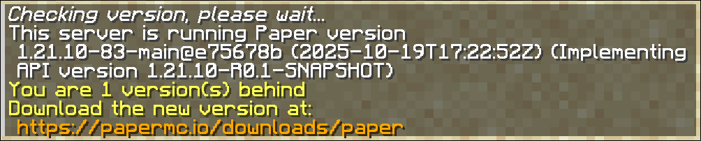
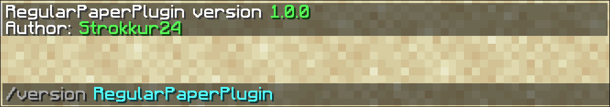
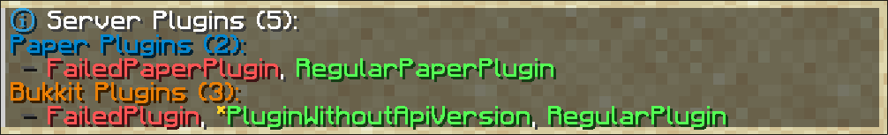

Esta página explica todos los comandos que añade Paper.

## Comandos de Bukkit

Estos comandos se encuentran en el espacio de nombres `bukkit:`.

### version (aliases: ver, about)

El comando version muestra información sobre la versión del servidor. El resultado puede parecerse a esto:



También puedes usar este comando para mostrar información de versión de plugins concretos.



### plugins (alias: pl)

El comando plugins muestra una lista de todos los plugins cargados. Paper distingue dos tipos de
plugins: **plugins de Paper** y **plugins de Bukkit**. Por lo general, esta diferencia solo es relevante para quienes desarrollan plugins
([guía de paper-plugin.yml](/es/paper/dev/getting-started/paper-plugins)). Los plugins aparecen en **verde**
si no se produjeron problemas al habilitarlos y se puede asumir que funcionan.
Los plugins en **rojo** no se pudieron cargar o se desactivaron. Si ocurre esto, consulta los registros de inicio para obtener más información.

Además, los plugins de Bukkit pueden cargarse **con la compatibilidad heredada** habilitada. Estos
aparecen con una **estrella amarilla** delante del nombre. Normalmente significa que el plugin se creó para una
versión muy antigua del juego o que su autor olvidó especificar una versión objetivo de Minecraft.

Puedes hacer clic en el nombre de un plugin para mostrar su información de versión. Esta acción equivale
a ejecutar `/version <plugin_name>`.



### help (alias: ?)

El comando help muestra descripciones de todos los comandos registrados. Sirve
como referencia rápida tanto para los comandos integrados como para los que añaden los plugins.

### reload (alias: spigot reload)

:::danger[Obsolescencia]

El comando reload está obsoleto y se eliminará. Si quieres actualizar los plugins, reinicia el servidor,
ya que se sabe que reload causa problemas con ellos.

Si quieres volver a cargar las configuraciones de Paper, puedes usar [/paper reload](#reload).

:::

## Análisis del rendimiento

Aunque los comandos `/mspt` y `/tps` funcionan correctamente, el comando `/spark` los ha sustituido,
así que deberías usar `/spark` en su lugar.

### spark

El único comando que deberías usar para obtener información de rendimiento es `/spark`.
Los subcomandos de spark están documentados [en la wiki dedicada a spark](https://spark.lucko.me/docs/Command-Usage).

### tps

El comando tps permite consultar los TPS (ticks por segundo, es decir, cuántas veces se ejecuta el bucle del juego
por segundo; cuanto mayor sea el valor, mejor. El objetivo es 20.0) del último minuto y de los últimos 5 y 15 minutos.

### mspt

El comando mspt permite consultar el MSPT medio, mínimo y máximo (milisegundos por tick, es decir, cuánto tarda
un tick; cuanto menor sea el valor, mejor. El MSPT debe ser inferior a 50 para alcanzar 20 TPS) del servidor durante los últimos 5, 10 y 60 segundos.

### timings

:::danger[Obsolescencia]

El comando timings está obsoleto y se eliminará. Deberías usar el [comando spark](#spark) en su lugar.

Puedes consultar más información aquí: https://github.com/PaperMC/Paper/discussions/10565.

:::

## restart

El comando `/restart` forma parte del mecanismo de reinicio de Spigot, que reinicia el servidor cuando este falla
o cuando se ejecuta el comando manualmente.

:::note

Para obtener ayuda para configurar el script de reinicio, consulta
[este gist de Prof_Bloodstone](https://gist.github.com/Prof-Bloodstone/6367eb4016eaf9d1646a88772cdbbac5).

:::

## paper
Esta sección está dedicada a los subcomandos del comando `/paper` del juego.

### chunkinfo
El comando `/paper chunkinfo [<world>]` muestra información sobre los chunks cargados de un mundo.
Puedes indicar el mundo con el argumento `[<world>]`. Si lo estableces en `*` o lo omites,
se mostrará información de todos los mundos.

El resultado distingue varios tipos de chunks cargados. A continuación se ofrece un resumen de cada tipo.
Encontrarás documentación más completa en la [wiki de Minecraft](https://minecraft.wiki/w/Chunk).

- `Total` Como su nombre indica, este número representa **todos los chunks** cargados actualmente.
- `Inactive` También conocidos como «inaccesibles», son chunks que no reciben ticks, pero en los que se genera el chunk.
- `Full` Normalmente llamados **chunks de borde**. No se ejecutan ticks, pero las entidades y los bloques están cargados y accesibles.
- `Block Ticking` Todos los aspectos del juego funcionan como se espera, excepto que las entidades no aparecen de forma natural ni reciben ticks, aunque siguen siendo accesibles. También se llaman **chunks perezosos**.
- `Entity Ticking` El chunk recibe todos los ticks.

### debug
El comando `/paper debug <chunks>` vuelca en un archivo información sobre todos los chunks cargados actualmente. El contenido
de este archivo normalmente no es relevante para la mayoría de los administradores de servidores y está destinado a los desarrolladores.

### dumpitem
Puedes usar el comando `/paper dumpitem [all]` para obtener la representación de componentes de datos del
objeto que tienes en la mano. Si ejecutas `/paper dumpitem`, obtendrás los datos del objeto, que puedes usar para representarlo en
comandos que acepten un argumento de objeto. `/paper dumpitem all` muestra la **representación completa de los componentes de datos**,
incluidos los componentes predeterminados que no es necesario declarar explícitamente.

### dumplisteners
El comando `/paper dumplisteners tofile|<className>` está dirigido principalmente a los desarrolladores que intentan averiguar por qué
sus controladores de eventos no funcionan como se espera. `/paper dumplisteners tofile` escribe en un archivo todos los
controladores de eventos registrados actualmente, mientras que `/paper dumplisteners <className>` muestra únicamente los controladores
registrados para el evento especificado.

### dumpplugins
El comando `/paper dumpplugins` está destinado a los desarrolladores que intentan resolver problemas con las dependencias o
el orden de carga de otros plugins. También se puede usar para depurar proveedores de bootstrapper, el orden general de carga
y los cargadores de clases de los plugins.

### entity
El comando `/paper entity list [<filter>] [<world>]` muestra todas las entidades que reciben ticks actualmente.

El argumento `[<filter>]` filtra los tipos de entidad mostrados y funciona de forma similar a una **expresión regular**:
- Puedes usar `*` para mostrar **todas** las entidades; es el valor predeterminado de este argumento.
- Puedes mostrar entidades concretas proporcionando `minecraft:<entity_type>` como argumento. En este caso, el espacio de nombres es muy importante.
- Para mostrar varias entidades, puedes usar `*` como comodín codicioso. Por ejemplo, para mostrar todas las entidades
  cuyos nombres empiezan por **e**, puedes usar `minecraft:e*`.
- También puedes usar `?` como comodín de un solo carácter. Por ejemplo, para mostrar `pig` y `piglin`, pero **no**
  `piglin_brute`, puedes proporcionar `minecraft:pig???` como filtro.

El argumento `[<world>]` indica el mundo cuyas entidades quieres consultar. De forma predeterminada, se usa el mundo actual
del jugador o el Overworld si se ejecuta desde la consola.

El resultado será parecido a este:

```
Total Ticking: -78, Total Non-Ticking: 92
  10 (3) : minecraft:pig
  1 (0) : minecraft:piglin
* El primer número corresponde a las entidades que procesan ticks; el segundo, a las que no.
```

El comentario final ya explica claramente qué representan los números.

### fixlight
El comando `/paper fixlight` inicia un recálculo completo del mapa de iluminación de todos los chunks
cargados actualmente. Puede servir para corregir problemas de iluminación que suelen aparecer con plugins como WorldEdit.

### heap
`/paper heap` es un comando de depuración para desarrolladores que vuelca el heap actual de JVM en un archivo `.hprof`. Este archivo se puede analizar
para detectar cuánta memoria usan determinados objetos. El archivo de salida puede ser bastante grande, así que se recomienda disponer de algo de espacio libre
en el disco antes de ejecutar el comando (por lo general, el archivo suele ser más pequeño
que la memoria usada actualmente. Puedes comprobar el consumo de memoria con el comando `/spark healthreport`).

### holderinfo
El comando `/paper holderinfo [<world>]` muestra el número de chunks de distintos tipos que se mantienen actualmente en memoria.

Puedes usar el argumento `[<world>]` para indicar el mundo cuyos datos de chunks quieres consultar. Déjalo vacío
para usar `*` de forma predeterminada y mostrar la información de todos los chunks.

En general, los tipos significan lo siguiente:
- `Total` Número total de contenedores de chunks en memoria.
- `Unloadable` Número de chunks que se pueden descargar sin riesgo.
- `Null` Chunks que recibieron la señal de descarga, pero cuyos bloqueos de planificación siguen activos.
- `ReadOnly` Número de contenedores de chunks que se pueden leer, pero no modificar.
- `Proto` Chunk «prototipo»: un chunk completamente funcional cargado en memoria, pero que no está colocado actualmente en el mundo.
- `Full` Número de chunks colocados actualmente en el mundo.

### mobcaps
No debe confundirse con el subcomando [playermobcaps](#playermobcaps): el comando `/paper mobcaps [<world>]` muestra
los límites de criaturas **globales** para todos los jugadores de un mundo. El argumento `[<world>]` usa el Overworld de forma predeterminada,
pero puedes indicar otros mundos para consultar sus límites de criaturas. El comando también muestra cuántos
chunks permiten la aparición de criaturas.

### playermobcaps
El comando `/paper playermobcaps [<player>]` muestra los límites locales de criaturas de un jugador concreto. Si existe,
el argumento `[<player>]` usa de forma predeterminada al jugador que ejecutó el comando.

### reload
El comando `/paper reload` no es compatible y permite volver a cargar la configuración de Paper durante la ejecución. Si aparece algún problema
después de usarlo, asegúrate de reproducirlo en un servidor recién iniciado antes de pedir ayuda o
informar del problema. Ten en cuenta que este comando **no** vuelve a cargar configuraciones ajenas a Paper, como `spigot.yml`.

### syncloadinfo
El comando `/paper syncloadinfo [clear]` requiere que se establezca explícitamente el indicador de JVM `-Dpaper.debug-sync-loads=true`
antes de ejecutarlo. Históricamente se usaba para depurar durante el desarrollo de Paper, pero
el mecanismo que lo sustenta no se utiliza actualmente. Por tanto, el archivo generado **siempre** tendrá
este aspecto:

```json
{
 "worlds": []
}
```

Salvo para comprobar si se permite ejecutar el comando, el indicador de JVM no se usa.

### version
El comando `/paper version` es un alias del comando estándar `/version`.
