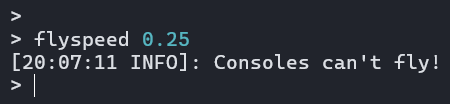
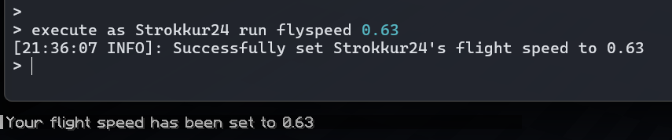

:::tip
Esta página requiere conocimientos sobre [Árboles de comandos](/es/paper/dev/command-api/basics/command-tree) y [Argumentos y literales](/es/paper/dev/command-api/basics/arguments-and-literals). Si no ha leído esos artículos, le recomendamos encarecidamente que los consulte de antemano.
:::
Esta página está dedicada al método `executes(...)` de la clase `ArgumentBuilder`.

## Examinando el método de ejecución.
El método `executes` se define de la siguiente manera:
```java title="ArgumentBuilder.java"
public T executes(Command<S> command);
```
La interfaz `Command<S>` se declara como `FunctionalInterface`. Eso significa que en lugar de incluir una clase que lo implemente, podemos simplemente pasar una expresión lambda.
```java title="Command.java"
@FunctionalInterface
public interface Command<S> {
    int SINGLE_SUCCESS = 1;

    int run(CommandContext<S> context) throws CommandSyntaxException;
}
```
Nuestra lambda tiene un parámetro y devuelve un número entero. Eso es esencialmente el método `run` definido en esa interfaz. El único parámetro, `CommandContext<S>` es aquel donde obtenemos toda la información sobre el remitente que ejecutó ese comando y todos los argumentos del comando. Tiene bastantes métodos, pero los principales de uso para nosotros son `S getSource()` y `V getArgument(String, Class<V>)`. Hemos echado un vistazo breve al `getArgument(...)` en el capítulo [Argumentos y literales](/es/paper/dev/command-api/basics/arguments-and-literals), pero en pocas palabras, este es el método del que podemos recuperar argumentos. Habrá ejemplos más específicos más adelante.

Deberías notar principalmente el parámetro genérico `S` por el método `getSource()`. Ese es el tipo de fuente del comando. Para el método de ejecución, este tipo es siempre `CommandSourceStack`. Esa clase en sí tiene estos métodos: `Location getLocation()`, `CommandSender getSender()` y `@Nullable Entity getExecutor()`. El método más utilizado es `getSender()`, ya que es el remitente del comando quien realmente ejecuta el comando. Para el destino de un comando, debe usar `getExecutor()`, lo cual es relevante si el comando se ejecutó a través de `/execute as <entity> run <our_command>`. No es necesariamente obligatorio, pero se considera una buena práctica.

## Ejemplo: comando de velocidad de vuelo
En el capítulo [Argumentos y literales](/es/paper/dev/command-api/basics/arguments-and-literals), hemos declarado brevemente la estructura de un comando `/flyspeed` con el uso de un argumento flotante a distancia. Pero ese comando en realidad no establece la velocidad de vuelo del jugador que lo ejecuta. Para hacer eso, tendríamos que agregarle un ejecutor, como este:
```java {4-6}
Commands.literal("flyspeed")
    .then(Commands.argument("speed", FloatArgumentType.floatArg(0, 1.0F))
        .executes(context -> {
            CommandSender sender = context.getSource().getSender(); // Obtiene el remitente del comando
            // Obtén el ejecutor del comando, que puede ser o no el mismo emisor.
            Entity executor = context.getSource().getExecutor();

            // Comprueba si el ejecutor es un jugador, ya que solo puedes cambiar la velocidad de vuelo de un jugador.
            if (!(executor instanceof Player player)) {
                // Si un ejecutor que no es jugador intenta cambiar su propia velocidad de vuelo...
                sender.sendPlainMessage("Only players can fly!");
                return Command.SINGLE_SUCCESS;
            }

            float speed = FloatArgumentType.getFloat(context, "speed"); // Obtiene el argumento de velocidad
            // Establece la velocidad del jugador.
            player.setFlySpeed(speed);

            if (sender == player) {
                // Si el jugador ejecutó el comando por su cuenta...
                player.sendPlainMessage("Successfully set your flight speed to " + speed);
            } else {
                // Si otro emisor estableció la velocidad (por ejemplo, mediante /execute)...
                sender.sendRichMessage("Successfully set <player_name>'s flight speed to <speed>",
                    Placeholder.component("player_name", player.displayName()),
                    Placeholder.unparsed("speed", String.valueOf(speed))
                );
                player.sendPlainMessage("Your flight speed has been set to " + speed);
            }
            return Command.SINGLE_SUCCESS;
        })
    )
```
### Explicación
Hay mucho que analizar, así que analicémoslo de arriba a abajo:

Las primeras líneas definen una raíz de comando `/flyspeed`, con un argumento flotante llamado "velocidad", que solo permite valores entre 0 y 1.

Tenga en cuenta las líneas resaltadas. Primero recuperamos el `CommandSourceStack` de nuestro `CommandContext<CommandSourceStack>` y finalmente recuperamos su remitente y ejecutor. Un `CommandSender` es una interfaz que declara los métodos `sendMessage(...)`, `getServer()` y `getName()`. Lo implementan todas las entidades, incluidos los jugadores, y el `ConsoleCommandSender`, que se utiliza si una consola ejecuta un comando.

A continuación comprobamos si nuestro objeto ejecutor también es una instancia de `Player`. Si el ejecutor fuera nulo, esto sería falso, por lo que no requerimos ninguna verificación nula. Si la expresión se evalúa como verdadera, obtenemos una nueva variable `player`, que representa un jugador real en el servidor donde se ejecutó el comando.

Luego, configuramos la velocidad de vuelo del jugador utilizando el valor recuperado del argumento flotante proporcionado por el jugador y le enviamos un mensaje para confirmar la operación. Siempre se recomienda enviar un mensaje de confirmación si el comando fue exitoso, porque de lo contrario un jugador podría confundirse sobre por qué un comando "no funciona". Si el ejecutor no era un jugador, podemos enviar un formulario de mensaje de error. En nuestro caso, asumimos que el remitente es una consola, ya que una entidad normalmente no intenta enviar dicho comando.

Finalmente, simplemente regresamos de la expresión lambda proporcionando un valor de retorno. Como nuestro comando tuvo éxito, podemos devolver `Command.SINGLE_SUCCESS`, cuyo valor es `1`. ¡No olvides cerrar todos tus brackets!

La ejecución del comando ahora funciona correctamente:  

Incluso podemos ejecutarlo como otro jugador, usando `/execute as`: 

### Separación lógica
A veces, si el comando es demasiado grande o debido a preferencias personales, es posible que no desee tener su código lógico en su alcance de ejecución, ya que podría ser ilegible debido a la cantidad de sangrías. En tal caso, podemos, en lugar de definir nuestra lógica directamente en la expresión lambda, utilizar otro método. Para eso podemos simplemente llamar a nuestro método en el alcance de ejecución. Esto podría verse así:
```java title="FlightSpeedCommand.java"
public class FlightSpeedCommand {

    public static LiteralCommandNode<CommandSourceStack> createCommand() {
      return Commands.literal("flyspeed")
          .then(Commands.argument("speed", FloatArgumentType.floatArg(0, 1.0F))
              .executes(context -> setFlySpeed(
                  context,
                  FloatArgumentType.getFloat(context, "speed") // este patrón también permite crear argumentos opcionales fácilmente
              ))
          )
          .build();
    }

    private static int setFlySpeed(CommandContext<CommandSourceStack> context, float speed) {
        CommandSender sender = context.getSource().getSender(); // Obtiene el remitente del comando
        Entity executor = context.getSource().getExecutor(); // Obtiene quien ejecuta el comando, que puede ser o no el remitente

        // Comprueba si el ejecutor es un jugador, ya que solo puedes cambiar la velocidad de vuelo de un jugador.
        if (!(executor instanceof Player player)) {
            // Si un ejecutor que no es jugador intenta cambiar su propia velocidad de vuelo...
            sender.sendPlainMessage("¡Solo los jugadores pueden volar!");
            return Command.SINGLE_SUCCESS;
        }

        // Establece la velocidad del jugador.
        player.setFlySpeed(speed);

        if (sender == player) {
            // Si el jugador ejecutó el comando por su cuenta...
            player.sendPlainMessage("La velocidad de vuelo se estableció en " + speed);
        } else {
            // Si otro emisor estableció la velocidad (por ejemplo, mediante /execute)...
            sender.sendRichMessage("La velocidad de vuelo de <player_name> se estableció en <speed>",
                Placeholder.component("player_name", player.displayName()),
                Placeholder.unparsed("speed", String.valueOf(speed))
            );
            player.sendPlainMessage("Tu velocidad de vuelo se estableció en " + speed);
        }
        return Command.SINGLE_SUCCESS;
    }
}
```
Como puede ver, hemos hecho que nuestro árbol de comandos sea fácilmente legible y al mismo tiempo conservamos la misma funcionalidad.
