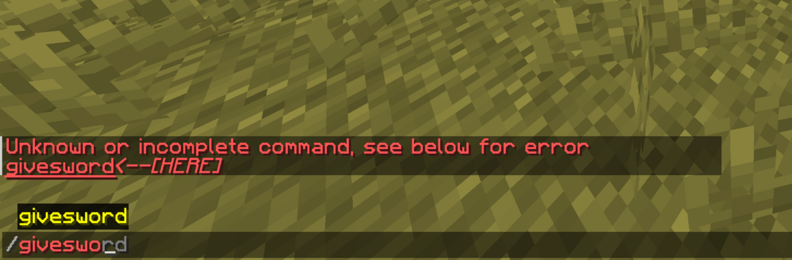
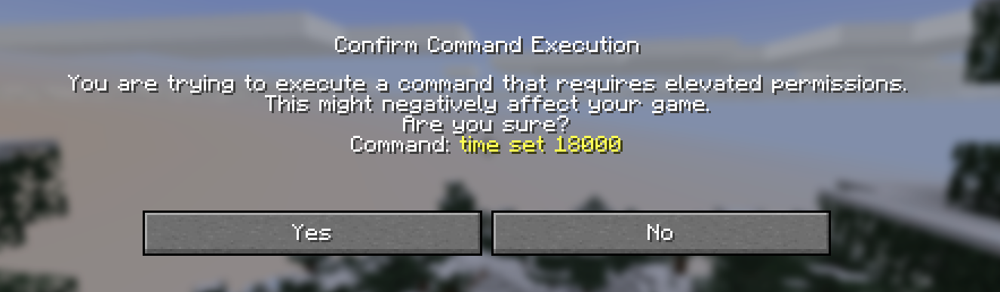
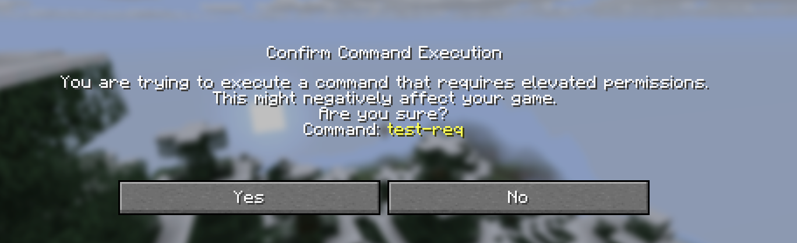

A veces querrás limitar la capacidad de un jugador para usar o ver ciertos comandos o subcomandos. Para eso, la clase `ArgumentBuilder<S>` tiene el método `requires(Predicate<S>)`, que define los requisitos para usar una rama específica del árbol de comandos. Como siempre, el parámetro genérico `S` es solo un `CommandSourceStack`, que nos proporciona la entidad ejecutora, el remitente y la ubicación del comando.

## Definición de permisos
Uno de los casos de uso más comunes de requisitos son los permisos. Por lo general, estos se verifican en el **remitente del comando**, ya que esa es la entidad/consola/objeto real que ejecutó el comando, incluso si se ejecuta como otra persona (el ejecutor). Un comando simple con permiso podría verse así:
```java
Commands.literal("testcmd")
    .requires(source -> source.getSender().hasPermission("permission.test"))
    .executes(context -> {
        context.getSource().getSender().sendRichMessage("<gold>Tienes permiso para ejecutar este comando.");
        return Command.SINGLE_SUCCESS;
    })
```
Este comando requiere que el remitente tenga el permiso `permission.test`. Pero no sólo puedes definir permisos, también puedes exigir que un remitente sea un operador del servidor, así:
```java
Commands.literal("testcmd")
    .requires(source -> source.getSender().isOp())
    .executes(context -> {
        context.getSource().getSender().sendRichMessage("<gold>Eres operador del servidor.");
        return Command.SINGLE_SUCCESS;
    })
```
## Definición de predicados más avanzados
No tienes que limitarte a comprobar permisos: como se trata de un predicado, puedes devolver cualquier valor booleano. Por ejemplo, puedes comprobar si un jugador tiene una espada de diamante en el inventario:
```java
Commands.literal("givesword")
    .requires(source -> source.getExecutor() instanceof Player player && !player.getInventory().contains(Material.DIAMOND_SWORD))
    .executes(context -> {
        context.getSource().getPlayerOrThrow().getInventory().addItem(ItemStack.of(Material.DIAMOND_SWORD));
        return Command.SINGLE_SUCCESS;
    })
```
Esto funciona, pero tiene un problema: como el cliente desconoce el requisito, muestra el comando como disponible aunque la condición sea falsa. Si el jugador intenta ejecutarlo, el servidor responde que el comando no existe:



¿Cómo podemos solucionar esto? La interfaz `Player` tiene un método llamado [`updateCommands()`](jd:paper:org.bukkit.entity.Player#updateCommands()) solo para este caso de uso. Reenvía los comandos actualmente registrados al cliente en un intento de recargar los comandos. Por ahora, podemos crear un nuevo comando con el que el jugador puede actualizar sus propios comandos para resincronizar su estado de comando:
```java
Commands.literal("reloadcommands")
    .executes(context -> {
        final Player player = context.getSource().getPlayerOrThrow();
        player.updateCommands();
        player.sendRichMessage("<gold>Tus comandos se actualizaron correctamente.");

        return Command.SINGLE_SUCCESS;
    })
```
### Automatización de recargas de comandos
Obligar a un jugador a recargar sus propios comandos no es una opción viable para la experiencia del usuario. Por este motivo, puedes **automatizar** este comportamiento. Es seguro llamar al método de comandos de actualización tantas veces como sea necesario, pero generalmente se debe evitar, ya que puede costar una gran cantidad de ancho de banda. Si es posible, deberías colocarlos en lugares muy específicos. Además, este método es completamente seguro para subprocesos, lo que significa que puedes llamarlo desde un contexto asincrónico.

## Comandos restringidos
Desde 1.21.6 en adelante, ahora se pueden restringir los comandos. Vanilla utiliza esta característica para que un jugador confirme si realmente desea ejecutar un comando desde un evento de clic de ejecutar comando. Eso incluye los de componentes de texto o botones de diálogo. Todos los comandos Vanilla, que requieren el estado de operador de forma predeterminada, están restringidos:



### Restringir tus comandos
Puedes aplicar el mismo comportamiento a tus comandos envolviendo el predicado de `.requires` con `Commands.restricted(...)`. Una implementación sencilla podría quedar así:
```java
Commands.literal("test-req")
    .requires(Commands.restricted(source -> true))
    .executes(context -> {
        context.getSource().getSender().sendPlainMessage("¡Cumpliste los requisitos!");
        return Command.SINGLE_SUCCESS;
    })
```


<br />

Dentro del método `.restricted` puedes poner cualquier lógica que pondrías en tu método `.requires`. No es más que una simple envoltura alrededor del predicado habitual `.requires`:
```java
Commands.literal("mycommand")
    .requires(Commands.restricted(source -> source.getSender().hasPermission("my.custom.permission")
                                            && source.getExecutor() instanceof Player player
                                            && player.getGameMode() == GameMode.ADVENTURE))
    .executes(context -> {
        // Lógica del comando
    })
```
