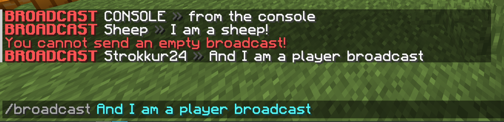

Para comandos muy simples, Paper tiene una forma de declarar comandos estilo Bukkit implementando la interfaz [](jd:paper:io.papermc.paper.command.brigadier.BasicCommand).

Esta interfaz tiene un método que debes anular:
- `void execute(CommandSourceStack source, String[] args)`

Y tres métodos más opcionales que puede, pero no es necesario, anular:
- `Collection<String> suggest(CommandSourceStack source, String[] args)`
- `boolean canUse(CommandSender sender)`
- `@Nullable String permission()`

## Uso sencillo
Al implementar el método de ejecución, su clase podría verse así:
```java title="YourCommand.java"
public class YourCommand implements BasicCommand {

    @Override
    public void execute(final CommandSourceStack source, final String[] args) {

    }
}
```
Con un `CommandSourceStack` puede recuperar información básica sobre el remitente del comando, la ubicación desde la que se envió el comando y la entidad para la que se ejecutó el comando. Puede encontrar más información en [nuestra página sobre ejecutores de comandos](/es/paper/dev/command-api/basics/executors).

## Los métodos opcionales
Puede elegir libremente si desea implementar cualquiera de los métodos opcionales mencionados. Aquí hay una descripción general rápida de lo que hace cada uno:

### `suggest(CommandSourceStack, String[])`
Este método devuelve algún tipo de `Collection<String>` y toma `CommandSourceStack` y `String[] args` como parámetros. Esto es similar al método `onTabComplete(CommandSender, Command, String, String[])` de la interfaz `TabCompleter`, que se utiliza para completar tabulaciones en los comandos de Bukkit.

Cada entrada de la colección que devuelva se enviará al cliente para que se muestre como sugerencias de la misma manera que con los comandos de Bukkit.

### `canUse(CommandSender)`
Con este método, puede configurar una estructura básica `requires` desde los comandos de Brigadier. [Puedes leer más sobre esto aquí](/es/paper/dev/command-api/basics/requirements). Este método devuelve un `boolean`, que es necesario devolver `true` para que un remitente de comando pueda ejecutar ese comando.
:::note
Si anula este método, anular `permission()` no hace nada. Esto se debe a que la implementación predeterminada usa el valor de retorno de `permission()`, que ya no se usaría si lo anulara.
```java title="BasicCommand.java"
default boolean canUse(final CommandSender sender) {
    final String permission = this.permission();
    return permission == null || sender.hasPermission(permission);
}
```

:::
### `permission()`
Con el método de permiso, de forma similar al método `canUse`, puede establecer el permiso necesario para poder ejecutar y ver este comando.

## Registrar comandos básicos
Registrar un `BasicCommand` es muy simple: en la clase principal de su complemento, simplemente puede llamar a uno de los métodos [`registerCommand(...)`](jd:paper:org.bukkit.plugin.java.JavaPlugin#registerCommand(java.lang.String,io.papermc.paper.command.brigadier.BasicCommand)) dentro del método `onEnable`.
```java title="ExamplePlugin.java"
public final class ExamplePlugin extends JavaPlugin {

    @Override
    public void onEnable() {
        BasicCommand yourCommand = ...;
        this.registerCommand("mycommand", yourCommand);
    }
}
```
### Los comandos básicos son interfaces funcionales.
Como solo tiene que anular un método, puede pasar directamente una expresión lambda. Esto no se recomienda por motivos de estilo, ya que dificulta la lectura del código.
```java
@Override
public void onEnable() {
    this.registerCommand(
        "quickcmd",
        (source, args) -> source.getSender().sendRichMessage("<yellow>Hello!")
    );
}
```
## Ejemplo: comando de transmisión
Como ejemplo, podemos crear un comando de transmisión simple. Comenzamos declarando la creación de una clase que implementa `BasicCommand` y anula `execute` y `permission`:
```java title="BroadcastCommand.java"
public class BroadcastCommand implements BasicCommand {

    @Override
    public void execute(final CommandSourceStack source, final String[] args) {

    }

    @Override
    public String permission() {
        return "example.broadcast.use";
    }
}
```
El permiso está establecido en `example.broadcast.use`. Para concederlo, se recomienda utilizar un complemento como [LuckPerms](https://luckperms.net) o simplemente otorgarse permisos de operador. También puede configurar este permiso para que sea `true` de forma predeterminada. Para ello, consulte la [documentación de plugin.yml](/es/paper/dev/plugin-yml).

Ahora, en nuestro método `execute`, le decimos al remitente que se requiere al menos un argumento para enviar una transmisión en caso de que no haya definido ningún argumento (lo que significa que `args` tiene una longitud de 0):
```java
if (args.length == 0) {
    source.getSender().sendRichMessage("<red>No puedes enviar un anuncio vacío.");
    return;
}
```
A continuación, podemos recuperar el nombre del ejecutor de ese comando. Si no encontramos uno, podemos obtener el nombre del remitente del comando, así:
```java
final Component name = Objects.requireNonNullElseGet(source.getExecutor(), source::getSender).name();
```
Esto asegura que cubrimos todos los casos e incluso permitimos que el comando funcione correctamente con `/execute as`.

Finalmente, podemos construir nuestro mensaje de difusión uniendo los argumentos a una cadena y enviándolo vía `Bukkit.broadcast(Component)`:
```java
final String message = String.join(" ", args);
final Component broadcastMessage = MiniMessage.miniMessage().deserialize(
    "<red><bold>BROADCAST</red> <name> <dark_gray>»</dark_gray> <message>",
    Placeholder.component("name", name),
    Placeholder.unparsed("message", message)
);

Bukkit.broadcast(broadcastMessage);
```
¡Y hemos terminado! Como puede ver, esta es una forma muy sencilla de definir comandos. Aquí está el resultado final de nuestra clase:
```java title="BroadcastCommand.java"
public class BroadcastCommand implements BasicCommand {

    @Override
    public void execute(final CommandSourceStack source, final String[] args) {
        if (args.length == 0) {
            source.getSender().sendRichMessage("<red>No puedes enviar un anuncio vacío.");
            return;
        }

        final Component name = Objects.requireNonNullElseGet(source.getExecutor(), source::getSender).name();

        final String message = String.join(" ", args);
        final Component broadcastMessage = MiniMessage.miniMessage().deserialize(
            "<red><bold>BROADCAST</red> <name> <dark_gray>»</dark_gray> <message>",
            Placeholder.component("name", name),
            Placeholder.unparsed("message", message)
        );

        Bukkit.getServer().broadcast(broadcastMessage);
    }

    @Override
    public String permission() {
        return "example.broadcast.use";
    }
}
```
El registro del comando se ve así:
```java
@Override
public void onEnable() {
    this.registerCommand("broadcast", new BroadcastCommand());
}
```
Y así es como se ve en el juego: 


### Agregar sugerencias
Nuestro comando de transmisión funciona bastante bien, pero le faltan sugerencias. Un tipo muy común de sugerencia para comandos basados ​​en texto son los nombres de los jugadores. Para sugerir nombres de jugadores, podemos asignar todos los jugadores en línea a su nombre, así:
```java
@Override
public Collection<String> suggest(final CommandSourceStack source, final String[] args) {
    return Bukkit.getOnlinePlayers().stream().map(Player::getName).toList();
}
```
Esto funciona muy bien, pero como puedes ver aquí, siempre sugerirá todos los jugadores, independientemente de la entrada del usuario, lo que a veces puede parecer poco natural: 

Para solucionar este problema, tenemos que hacer algunos cambios:

Primero, devolvemos anticipadamente lo que ya tenemos en caso de que no haya argumentos, ya que entonces no podemos filtrar por entrada:
```java
if (args.length == 0) {
    return Bukkit.getOnlinePlayers().stream().map(Player::getName).toList();
}
```
Después de esto, podemos agregar un paso `filter` a nuestra secuencia, donde filtramos todos los nombres según si comienzan con nuestra entrada actual, que es `args[args.length - 1]`:
```java
return Bukkit.getOnlinePlayers().stream()
    .map(Player::getName)
    .filter(name -> name.toLowerCase().startsWith(args[args.length - 1].toLowerCase()))
    .toList();
```
¡Y hemos terminado! Como puede ver, las sugerencias aún funcionan bien: 

Pero cuando no hay ningún jugador que comience con una entrada, simplemente no sugiere nada: 

### Código final
Aquí está el código final para toda nuestra clase `BroadcastCommand`, incluidas las sugerencias:
```java title="BroadcastCommand.java"
public class BroadcastCommand implements BasicCommand {

    @Override
    public void execute(final CommandSourceStack source, final String[] args) {
        if (args.length == 0) {
            source.getSender().sendRichMessage("<red>No puedes enviar un anuncio vacío.");
            return;
        }

        final Component name = Objects.requireNonNullElseGet(source.getExecutor(), source::getSender).name();

        final String message = String.join(" ", args);
        final Component broadcastMessage = MiniMessage.miniMessage().deserialize(
            "<red><bold>ANUNCIO</red> <name> <dark_gray>»</dark_gray> <message>",
            Placeholder.component("name", name),
            Placeholder.unparsed("message", message)
        );

        Bukkit.getServer().broadcast(broadcastMessage);
    }

    @Override
    public String permission() {
        return "example.broadcast.use";
    }

    @Override
    public Collection<String> suggest(final CommandSourceStack source, final String[] args) {
        if (args.length == 0) {
            return Bukkit.getOnlinePlayers().stream().map(Player::getName).toList();
        }

        return Bukkit.getOnlinePlayers().stream()
            .map(Player::getName)
            .filter(name -> name.toLowerCase().startsWith(args[args.length - 1].toLowerCase()))
            .toList();
    }
}
```
