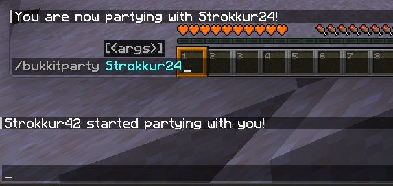
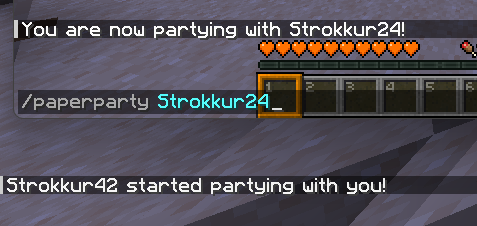

## Registrar comandos
### A la antigua usanza de Bukkit

Para registrar comandos de Bukkit mediante programación, defines una clase que extienda `Command` e implemente los métodos `execute(...)` y `tabComplete(...)`. Quedaría así:
```java title="BukkitPartyCommand.java"
public class BukkitPartyCommand extends Command {
    public BukkitPartyCommand(final String name, final String description, final String usageMessage, final List<String> aliases) {
        super(name, description, usageMessage, aliases);
    }

    @Override
    public boolean execute(final CommandSender sender, final String commandLabel, final String[] args) {
        if (args.length == 0) {
            sender.sendRichMessage("<red>Indica un jugador.");
            return false;
        }

        final Player target = Bukkit.getPlayerExact(args[0]);
        if (target == null) {
            sender.sendRichMessage("<red>Indica un jugador válido.");
            return false;
        }

        target.sendPlainMessage(sender.getName() + " está de fiesta contigo.");
        sender.sendPlainMessage("Ahora estás de fiesta con " + target.getName() + ".");
        return true;
    }

    @Override
    public List<String> tabComplete(final CommandSender sender, final String alias, final String[] args) throws IllegalArgumentException {
        if (args.length == 1) {
            return Bukkit.getOnlinePlayers().stream().map(Player::getName).toList();
        }

        return List.of();
    }
}
```
Después de eso, puedes definir tu comando así en tu clase principal:
```java
this.getServer().getCommandMap().register(
    this.getName().toLowerCase(),
    new BukkitPartyCommand("bukkitparty", "Celebra una fiesta", "/bukkitparty <player>", List.of())
);
```
Como puedes ver, debes hacer muchas comprobaciones manuales para registrar un comando sencillo. Pero ¿cómo se hace con la API de Brigadier?

### La nueva forma del Paper
Primero, necesitamos recuperar un `LiteralCommandNode<CommandSourceStack>`. Esa es una clase de Brigadier especial que contiene algún tipo de [árbol de comandos](/es/paper/dev/command-api/basics/command-tree). En nuestro caso, es la raíz de nuestro comando. Podemos hacerlo ejecutando `Commands.literal(String literal)`, que devuelve un `LiteralArgumentBuilder<CommandSourceStack>`, donde podemos definir algunos argumentos y ejecutores. Una vez que hayamos terminado, podemos llamar a `LiteralArgumentBuilder#build()` para recuperar nuestra compilación `LiteralCommandNode`, que luego podemos registrar. Esto suena complicado al principio, pero una vez que lo ves en acción, parece menos aterrador:
```java
public static LiteralCommandNode<CommandSourceStack> createCommand(final String commandName) {
    return Commands.literal(commandName)
        .then(Commands.argument("target", ArgumentTypes.player())
            .executes(context -> {
                final PlayerSelectorArgumentResolver resolver = context.getArgument("target", PlayerSelectorArgumentResolver.class);
                final Player target = resolver.resolve(context.getSource()).getFirst();
                final CommandSender sender = context.getSource().getSender();

                target.sendPlainMessage(sender.getName() + " está de fiesta contigo.");
                sender.sendPlainMessage("Ahora estás de fiesta con " + target.getName() + ".");

                return Command.SINGLE_SUCCESS;
            }))
        .build();
}
```
Cada `.then(...)` define una nueva rama en nuestro árbol, que puede ser un literal (`Commands.literal(String)`) o un argumento (`Commands.argument(String, ArgumentType<T>)`). Cada rama puede o no definir un ejecutor `.executes(Command)`. Aquí es donde ocurre toda la lógica.

Lo veremos más de cerca en diferentes páginas, pero por ahora, ¿cómo lo registramos? El Paper utiliza un sistema `LifecycleEventManager`. En pocas palabras, esa es una forma de registrar comandos (o etiquetas) que se cargan cada vez que el servidor recarga sus recursos, como usar `/reload`. Registrar nuestro comando en la clase principal se ve así:
```java
this.getLifecycleManager().registerEventHandler(LifecycleEvents.COMMANDS, event -> {
    event.registrar().register(createCommand("paperparty"), "¡Que disfrutes de la fiesta!");
});
```
¡Y listo! Como puedes ver, ambos comandos hacen lo mismo:

<span style="display: flex;"> </span>
