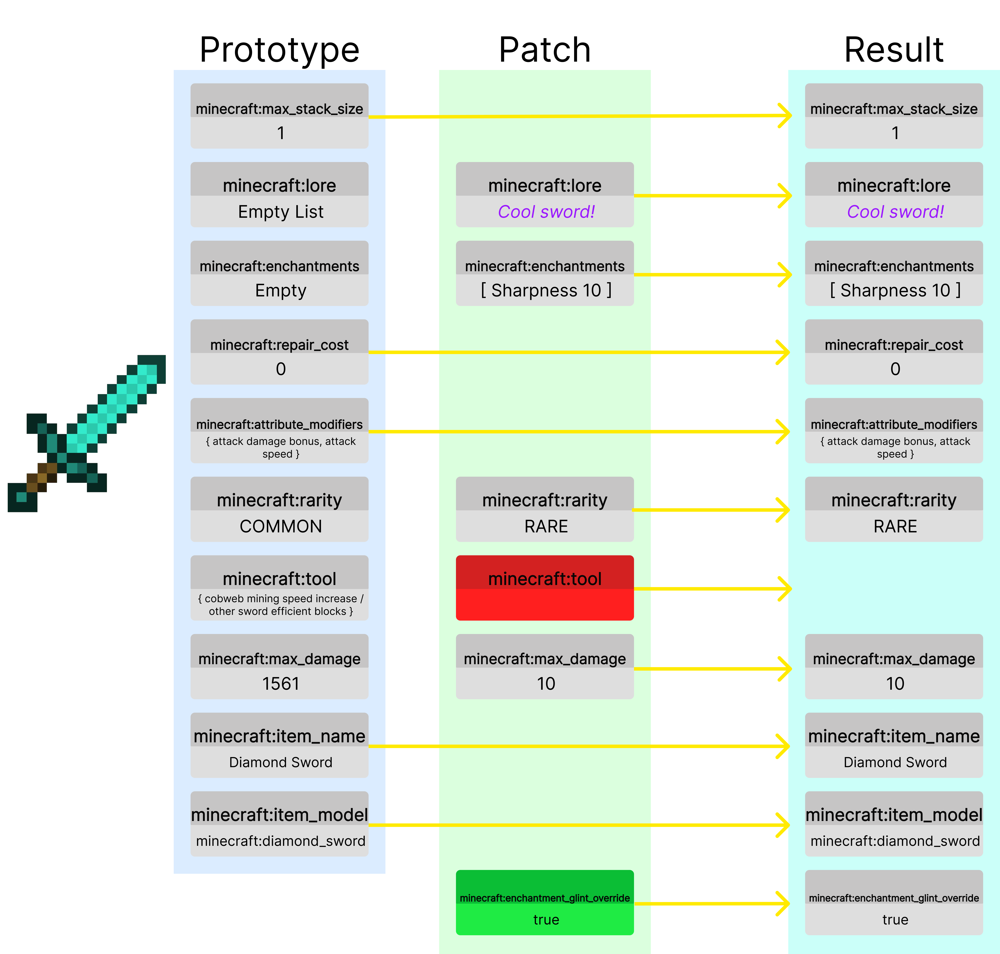

La API del componente de datos proporciona una interfaz específica de la versión para acceder y manipular datos de artículos que de otro modo no serían representables por la API `ItemMeta`. A través de esta API, puede leer y modificar las propiedades de un elemento, los llamados componentes de datos, de forma estable y orientada a objetos.


## Introducción

### ¿Qué es un componente de datos?
Un componente de datos representa un dato asociado con un elemento. Los elementos básicos pueden tener propiedades como datos de modelo personalizados, contenido de botín de contenedores, patrones de pancartas o efectos de pociones.

### Estructura
 Para obtener detalles de implementación, [haga clic aquí](#example-cool-sword).

#### El prototipo (valores predeterminados)
Los artículos vienen con un conjunto inicial de componentes que llamamos prototipo. Estos componentes están definidos en el `ItemType` del `ItemStack`. Controlan el comportamiento base del artículo, representando un artículo nuevo sin modificaciones.

El prototipo le da a los elementos sus propiedades iniciales, como si son comida, una herramienta, un arma, etc.

#### El parche
El parche representa las modificaciones realizadas al artículo. Esto puede incluir darle un nombre personalizado, modificar los encantamientos, dañarlo o agregar algo a la historia. El parche se aplica encima del prototipo, lo que nos permite realizar modificaciones en un elemento.

El parche también permite eliminar componentes que estaban previamente en el prototipo. Esto se muestra en rojo en el ejemplo `minecraft:tool`. Estamos eliminando este componente, por lo que este objeto de espada ya no romperá telarañas u otros bloques de espada más rápido.

También podremos añadir nuevos componentes, como se ve en el nuevo componente `minecraft:enchantment_glint_override`, que nos permite hacerlo parecer como si estuviera encantado.


## Diferencias respecto a `ItemMeta`

La API `ItemMeta` proporciona métodos para modificar `ItemStack` de manera jerárquica, como `CompassMeta`, que le permite modificar los componentes de un `minecraft:compass`. Si bien `ItemMeta` sigue siendo muy útil, no representa adecuadamente la relación prototipo/parche que utilizan los elementos de Minecraft.

### Diferencias clave

#### Modelo de datos ampliado
La API del componente de datos expone un conjunto mucho más amplio y detallado de propiedades de elementos que `ItemMeta`. Los componentes de datos permiten modificar todo el elemento de una manera que represente mejor cómo Minecraft realiza las modificaciones de elementos.
#### Versión específica
La API del componente de datos está diseñada para adaptarse a los cambios de versión. La API del componente de datos puede experimentar cambios importantes en las actualizaciones de versión a medida que Minecraft realiza cambios en los componentes. No se promete compatibilidad con versiones anteriores.

Debido a que `ItemMeta` está representado en un formato diferente, es posible que los cambios importantes realizados en los componentes por Mojang no resulten en cambios importantes en `ItemMeta`.

#### Constructores e inmutabilidad
Muchos componentes de datos complejos requieren un enfoque de construcción para su construcción y edición. Todos los tipos de datos que devuelve la API también son inmutables, por lo que no modificarán directamente el componente.

#### Solo parche
`ItemMeta` solo representa el parche de un `ItemStack`. Esto significa que no puede obtener las propiedades originales (prototipo) del `ItemStack`, como su durabilidad predeterminada o sus atributos predeterminados.

#### Sin instantáneas
Actualmente, `ItemMeta` representa una **instantánea** del mapa parcheado de un `ItemStack`. Esto es costoso ya que requiere leer todo el parche, incluso los valores que quizás no esté utilizando.

La API del componente de datos se integra directamente con `ItemStack`. Aunque conceptualmente similar, la API del componente de datos se centra en la recuperación y actualización de datos explícitos y fuertemente tipados sin esta sobrecarga adicional.

### ¿Cuándo debo usar `DataComponents` o `ItemMeta`?

Desea utilizar `ItemMeta` si:
- Solo están haciendo cambios simples en `ItemStack`.
- Quiere mantener la compatibilidad entre versiones de su complemento

Querrá utilizar componentes de datos si:
- Quiere modificaciones `ItemStack` más complicadas
- No te importa la compatibilidad entre versiones.
- Quiere acceder a los valores predeterminados (prototipo)
- Quiere eliminar componentes del prototipo de un `ItemStack`.


## Uso básico
La API del componente de datos obtendrá valores según el comportamiento observado en el juego. Entonces, si el parche elimina el componente `minecraft:tool`, intentar obtener ese componente devolverá nulo.

### Recuperando un valor de prototipo
```java
// Obtén la durabilidad predeterminada de una espada de diamante.
int defaultDurability = Material.DIAMOND_SWORD.getDefaultData(DataComponentTypes.MAX_DAMAGE)
```
### Buscando un componente de datos
```java
// Comprueba si este objeto tiene el componente de datos de nombre personalizado.
boolean hasCustomName = item.hasData(DataComponentTypes.CUSTOM_NAME);
logger.info("¿Tiene un nombre personalizado? {}", hasCustomName);
```
### Leer un componente de datos valioso
```java
// El daño de un objeto puede ser null, así que debemos comprobarlo.
Integer damageValue = item.getData(DataComponentTypes.DAMAGE);
if (damageValue != null) {
    logger.info("Daño actual: {}", damageValue);
} else {
    logger.info("Este objeto no tiene un componente de daño establecido.");
}

// Algunos componentes, como el tamaño máximo de la pila, siempre estarán presentes en un objeto.
Integer maxStackSize = item.getData(DataComponentTypes.MAX_STACK_SIZE);
```
### Establecer un componente de datos valioso
```java
// Establece un valor de datos de modelo personalizado para este objeto.
item.setData(DataComponentTypes.CUSTOM_MODEL_DATA, CustomModelData.customModelData()
    .addFloat(0.5F)
    .addFlag(true)
    .build()
);
```
### Eliminar o restablecer un componente de datos
```java
// Elimina un componente existente (por ejemplo, tool).
item.unsetData(DataComponentTypes.TOOL);

// Restablece un componente al valor predeterminado (prototipo) para el tipo de objeto (por ejemplo, el tamaño máximo de la pila).
item.resetData(DataComponentTypes.MAX_STACK_SIZE);
```
### Componentes de datos no valorados

Algunos componentes son sólo banderas y no tienen ningún tipo de valor:
```java
// Convierte el objeto en un planeador que se use como un élitro (en combinación con el componente de equipamiento).
item.setData(DataComponentTypes.GLIDER);

// Elimina la marca de planeador.
item.unsetData(DataComponentTypes.GLIDER);
```
## Uso avanzado con constructores

Muchos componentes de datos tienen estructuras complejas que requieren constructores.

### Modificación de los valores de los componentes del prototipo
```java
ItemStack helmet = ItemStack.of(Material.DIAMOND_HELMET);
// Obtén el componente de equipamiento de este objeto y conviértelo en un constructor.
// Nota: no todos los tipos tienen métodos .toBuilder().
// Este es el valor de prototipo del casco de diamante.
Equippable.Builder builder = helmet.getData(DataComponentTypes.EQUIPPABLE).toBuilder();

// Haz que el casco parezca de netherite.
// Obtenemos el valor de equipamiento de prototipo de NETHERITE_HELMET.
builder.assetId(Material.NETHERITE_HELMET.getDefaultData(DataComponentTypes.EQUIPPABLE).assetId());
// Reproduce un sonido espeluznante al equiparlo.
builder.equipSound(SoundEventKeys.ENTITY_GHAST_HURT.key());

// Establece el objeto nuevo.
helmet.setData(DataComponentTypes.EQUIPPABLE, builder);
```
Esto creará un casco de diamante que parece un casco de netherita y reproduce un sonido espeluznante cuando está equipado.

### Ejemplo: libro escrito
```java
ItemStack book = ItemStack.of(Material.WRITTEN_BOOK);
WrittenBookContent.Builder builder = WrittenBookContent.writtenBookContent("Mi libro", "Nombre del autor");

// Añade una página.
builder.addPage(Component.text("¡Esta es una página nueva!"));

// Añade una página que se muestre de forma distinta a quienes tengan activado el filtro de insultos.
// Los jugadores que hayan desactivado el filtro verán "¡Odio Paper!", mientras que quienes lo tengan activado verán "¡Me encanta Paper!".
builder.addFilteredPage(
    Filtered.of(Component.text("¡Odio Paper!"), Component.text("¡Me encanta Paper!"))
);

// Cambia la generación.
builder.generation(1);

// Aplica los cambios.
book.setData(DataComponentTypes.WRITTEN_BOOK_CONTENT, builder.build());
```
### Ejemplo: espada genial
```java
ItemStack sword = ItemStack.of(Material.DIAMOND_SWORD);
sword.setData(DataComponentTypes.LORE, ItemLore.lore().addLine(Component.text("¡Espada genial!")));
sword.setData(DataComponentTypes.ENCHANTMENTS, ItemEnchantments.itemEnchantments().add(Enchantment.SHARPNESS, 10));
sword.setData(DataComponentTypes.RARITY, ItemRarity.RARE);

sword.unsetData(DataComponentTypes.TOOL); // Elimina el componente tool.

sword.setData(DataComponentTypes.MAX_DAMAGE, 10);
sword.setData(DataComponentTypes.ENCHANTMENT_GLINT_OVERRIDE, true); // Haz que brille.
```
## Elementos coincidentes sin ciertos componentes de datos

Al comparar elementos, a veces desea ignorar ciertos valores. Para ello podemos utilizar el método [`ItemStack#matchesWithoutData`](jd:paper:org.bukkit.inventory.ItemStack#matchesWithoutData(org.bukkit.inventory.ItemStack,java.util.Set)).

Por ejemplo, aquí comparamos dos espadas de diamantes ignorando su durabilidad:
```java
ItemStack originalSword = ItemStack.of(Material.DIAMOND_SWORD);
ItemStack damagedSword = ItemStack.of(Material.DIAMOND_SWORD);
damagedSword.setData(DataComponentTypes.DAMAGE, 100);

boolean match = damagedSword.matchesWithoutData(originalSword, Set.of(DataComponentTypes.DAMAGE), false);
logger.info("¿Coinciden las espadas? {}", match); // -> true
```
