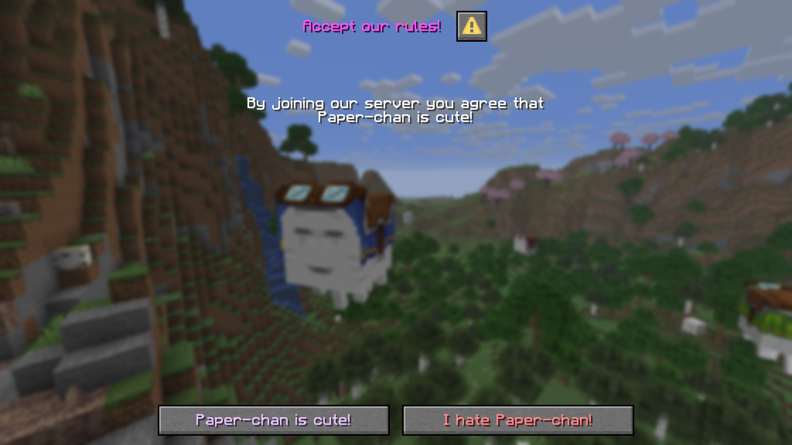
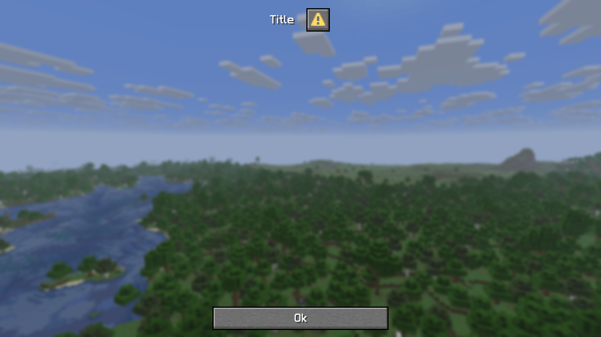

import Dependency from "/src/components/Dependency.astro";
import Video from "/src/components/Video.astro";
import { LATEST_ADVENTURE_API_RELEASE } from "/src/utils/versions";

import DialogShowcaseMp4 from "../../../../paper/dev/api/assets/dialogs/dialog-showcase.mp4?url";
import InputDialogShowcaseMp4 from "../../../../paper/dev/api/assets/dialogs/input-dialog-showcase.mp4?url";

Los [diálogos](https://minecraft.wiki/w/Dialog) llegaron a Minecraft en la actualización [1.21.6](https://minecraft.wiki/w/Java_Edition_1.21.6). Paper añadió una API para crear diálogos personalizados en la versión 1.21.7. Aquí se presenta esa API y sus posibilidades.

## ¿Qué es un diálogo?
Los diálogos permiten que los servidores muestren menús personalizados en el juego. Sirven para presentar información o recopilar datos del usuario.

Puedes mostrar diálogos durante la fase de configuración o mientras se juega. Por ejemplo:



El ejemplo muestra un diálogo de **confirmación**, que siempre contiene dos botones: uno para aceptar y otro para rechazar.

## Mostrar diálogos
Para mostrar un diálogo durante el juego, usa el comando `/dialog show <players> <dialog>` o la API [](jd:adventure:net.kyori.adventure.audience.Audience#showDialog(net.kyori.adventure.dialog.DialogLike)). La interfaz [](jd:paper:io.papermc.paper.dialog.Dialog) proporciona acceso a los diálogos integrados. Puedes crear diálogos en tiempo de ejecución con [`Dialog#create`](jd:paper:io.papermc.paper.dialog.Dialog#create(java.util.function.Consumer)) o, si los registras durante la fase de arranque, recuperarlos del registro mediante `RegistryAccess.registryAccess().getRegistry(RegistryKey.DIALOG).get(Key)`.

## Diálogos integrados
Hay tres cuadros de diálogo integrados:
- [Enlaces del servidor](jd:paper:io.papermc.paper.registry.keys.DialogKeys#SERVER_LINKS)
- [Acciones rápidas](jd:paper:io.papermc.paper.registry.keys.DialogKeys#QUICK_ACTIONS)
- [Opciones personalizadas](jd:paper:io.papermc.paper.registry.keys.DialogKeys#CUSTOM_OPTIONS)

### Agregar enlaces de servidor
Para añadir enlaces del servidor, obtén la instancia de [](jd:paper:org.bukkit.ServerLinks) mediante [`Bukkit.getServer().getServerLinks()`](jd:paper:org.bukkit.Server#getServerLinks()) y usa sus métodos de modificación. El jugador puede abrir el menú del juego con `esc` y seleccionar `Server Links...`. El botón solo aparece si hay enlaces configurados.

## Crear diálogos en tiempo de ejecución
Puedes crear un objeto [](jd:paper:io.papermc.paper.dialog.Dialog) con [`Dialog#create`](jd:paper:io.papermc.paper.dialog.Dialog#create(java.util.function.Consumer)). El consumidor permite configurar el diálogo. **Todo diálogo requiere una base y un tipo**, que se declaran en el constructor. Puedes crear una base nueva o partir de un diálogo [registrado](#registrar-dialogos).

Este ejemplo crea un diálogo sencillo de tipo aviso y lo muestra al jugador:

<details>
  <summary>Vista previa del juego</summary>
  
</details>
```java
Dialog dialog = Dialog.create(builder -> builder.empty()
    .base(DialogBase.builder(text("Title")).build())
    .type(DialogType.notice())
);
player.showDialog(dialog);
```
### Base de diálogo
Puede crear una base de diálogo usando su [constructor](jd:paper:io.papermc.paper.registry.data.dialog.DialogBase$Builder), que se puede crear usando [](jd:paper:io.papermc.paper.registry.data.dialog.DialogBase#builder(net.kyori.adventure.text.Component)). Una base de diálogo puede declarar los siguientes valores:

| Método | Descripción |
|-----------------------------------------------------------------------------------------------------------------------------------------------------------------------------------------------|--------------------------------------------------------|
| [`afterAction(DialogAfterAction)`](jd:paper:io.papermc.paper.registry.data.dialog.DialogBase$Builder#afterAction(io.papermc.paper.registry.data.dialog.DialogBase.DialogAfterAction)) | La acción a realizar después de cerrar el diálogo |
| [`canCloseWithEscape(boolean)`](jd:paper:io.papermc.paper.registry.data.dialog.DialogBase$Builder#canCloseWithEscape(boolean)) | Si el cuadro de diálogo se puede cerrar con la tecla `esc` |
| [`externalTitle(Component)`](jd:paper:io.papermc.paper.registry.data.dialog.DialogBase$Builder#externalTitle(net.kyori.adventure.text.Component)) | El título que se mostrará en los botones que abren este cuadro de diálogo |
| [`body(List<? extends DialogBody>)`](jd:paper:io.papermc.paper.registry.data.dialog.DialogBase$Builder#body(java.util.List)) | El cuerpo del diálogo.                                |
| [`inputs(List<? extends DialogInput>)`](jd:paper:io.papermc.paper.registry.data.dialog.DialogBase$Builder#inputs(java.util.List)) | Las entradas del diálogo.                              |

#### Cuerpo del diálogo
Un cuadro de diálogo puede contener una cantidad arbitraria de componentes del cuerpo. Se puede crear una entrada de cuerpo usando [](jd:paper:io.papermc.paper.registry.data.dialog.body.DialogBody#plainMessage(net.kyori.adventure.text.Component)) para mostrar texto o [](jd:paper:io.papermc.paper.registry.data.dialog.body.DialogBody#item(org.bukkit.inventory.ItemStack)) para mostrar elementos.
#### Entrada de diálogo
Hay cuatro formas de recopilar opiniones:

- [`DialogInput.bool`](jd:paper:io.papermc.paper.registry.data.dialog.input.DialogInput#bool(java.lang.String,net.kyori.adventure.text.Component))

   Una simple casilla de verificación que representa un estado verdadero o falso

   

- [`DialogInput.singleOption`](jd:paper:io.papermc.paper.registry.data.dialog.input.DialogInput#singleOption(java.lang.String,net.kyori.adventure.text.Component,java.util.List))

   Un botón de opción múltiple

   

- [`DialogInput.text`](jd:paper:io.papermc.paper.registry.data.dialog.input.DialogInput#text(java.lang.String,net.kyori.adventure.text.Component))

   Un campo de entrada de cadena simple

   

- [`DialogInput.numberRange`](jd:paper:io.papermc.paper.registry.data.dialog.input.DialogInput#numberRange(java.lang.String,net.kyori.adventure.text.Component,float,float))

   Un control deslizante para ingresar números

   


### Tipo de diálogo
La interfaz [](jd:paper:io.papermc.paper.registry.data.dialog.type.DialogType) define algunos métodos estáticos para los distintos tipos de diálogo. Existen los siguientes tipos:

| Tipo | Método | Descripción |
|-----------------|-----------------------------------------------------------------------------------------------------------------------------------------------------------------------------------------------------------------------------------------------------------|----------------------------------------------------|
| aviso | [`notice()`](jd:paper:io.papermc.paper.registry.data.dialog.type.DialogType#notice()) o [`notice(ActionButton button)`](jd:paper:io.papermc.paper.registry.data.dialog.type.DialogType#notice(io.papermc.paper.registry.data.dialog.ActionButton)) | Un diálogo sencillo con un solo botón |
| confirmación | [`confirmation(ActionButton yesButton, ActionButton noButton)`](jd:paper:io.papermc.paper.registry.data.dialog.type.DialogType#confirmation(io.papermc.paper.registry.data.dialog.ActionButton,io.papermc.paper.registry.data.dialog.ActionButton)) | Un diálogo con un botón de sí y no |
| lista de diálogo | [`dialogList(RegistrySet dialogs)`](jd:paper:io.papermc.paper.registry.data.dialog.type.DialogType#dialogList(io.papermc.paper.registry.set.RegistrySet)) | Un cuadro de diálogo para abrir los cuadros de diálogo especificados |
| múltiples acciones | [`multiAction(List<ActionButton> actions)`](jd:paper:io.papermc.paper.registry.data.dialog.type.DialogType#multiAction(java.util.List)) | Un cuadro de diálogo para mostrar varios botones |
| enlaces de servidores | [`serverLinks(ActionButton exitAction, int columns, int buttonWidth)`](jd:paper:io.papermc.paper.registry.data.dialog.type.DialogType#serverLinks(io.papermc.paper.registry.data.dialog.ActionButton,int,int)) | Un cuadro de diálogo de enlaces de servidor |

El tipo influye principalmente en la parte inferior del diálogo.

## Registrar diálogos
Si desea que los diálogos se registren en el registro de diálogos, debe registrarlos dentro de un evento del ciclo de vida de modificación del registro en el programa previo de su complemento. Alguna información general al respecto se puede leer [aquí](/es/paper/dev/registries).
:::tip
La ventaja de registrar diálogos en el registro es que le permite usar ese mismo diálogo en otras partes de su código sin tener que pasar el objeto `Dialog`. Esto también permite hacer referencia al diálogo en comandos con un parámetro de diálogo.
:::
El registro general es bastante similar a los cuadros de diálogo creados dinámicamente:
```java title="ExamplePluginBootstrap.java"
@Override
public void bootstrap(final BootstrapContext context) {
    context.getLifecycleManager().registerEventHandler(
        RegistryEvents.DIALOG.compose(),
        event -> event.registry().register(
            DialogKeys.create(Key.key("papermc:custom_dialog")),
            builder -> builder
                // Construye aquí tu diálogo...
                .base(DialogBase.builder(Component.text("Title")).build())
                .type(DialogType.notice())
        )
    );
}
```
{/* Comentado, hasta que las cosas sobre el ciclo de vida de las etiquetas obtengan la documentación adecuada
### Pausar adiciones de pantalla y acciones rápidas
Los cuadros de diálogo se pueden etiquetar con estas etiquetas especiales cuando se registran:
- [`DialogTagKeys.PAUSE_SCREEN_ADDITIONS`](jd:paper:io.papermc.paper.registry.keys.tags.DialogTagKeys#PAUSE_SCREEN_ADDITIONS)

   Los diálogos con esta etiqueta recibirán un botón en la pantalla de pausa del juego.

- [`DialogTagKeys.QUICK_ACTIONS`](jd:paper:io.papermc.paper.registry.keys.tags.DialogTagKeys#QUICK_ACTIONS)

   Los cuadros de diálogo con esta etiqueta recibirán un botón en el menú de acciones rápidas (accesible mediante la tecla `G` de forma predeterminada).

Para agregar su cuadro de diálogo personalizado a estas etiquetas, puede usar un controlador de eventos de registrador de etiquetas posterior al aplanamiento en su programa previo de esta manera:
```java title="YourPluginBootstrapper.java" showLineNumbers
@Override
public void bootstrap(BootstrapContext context) {
    TypedKey<Dialog> customDialogKey = DialogKeys.create(Key.key("papermc:custom_dialog"));
    context.getLifecycleManager().registerEventHandler(
        LifecycleEvents.TAGS.postFlatten(RegistryKey.DIALOG)
            .newHandler((ReloadableRegistrarEvent<PostFlattenTagRegistrar<Dialog>> event) -> {
                PostFlattenTagRegistrar<Dialog> registrar = event.registrar();
                registrar.addToTag(DialogTagKeys.PAUSE_SCREEN_ADDITIONS, List.of(customDialogKey));
                registrar.addToTag(DialogTagKeys.QUICK_ACTIONS, List.of(customDialogKey));
            })
    );
}
```
*/}

## Cerrar cuadros de diálogo
Los cuadros de diálogo se pueden cerrar desde la API. Hay dos formas de lograrlo:

- La forma prevista de uso [](jd:adventure:net.kyori.adventure.audience.Audience#closeDialog()).
- La forma ligeramente hacky de usar [](jd:paper:org.bukkit.entity.HumanEntity#closeInventory()).

El uso de `closeDialog()` hará que el cuadro de diálogo se cierre y el jugador regrese a la pantalla anterior sin diálogo o al menú del juego en la que se encontraba. Esto significa que cualquier inventario abierto previamente se mantendrá abierto.

Por el contrario, `closeInventory()` cerrará no sólo el cuadro de diálogo abierto actualmente, sino también cualquier otra pantalla, como un inventario abierto.

## Ejemplo: un cuadro de diálogo de confirmación de bloqueo
Si desea que sus jugadores lean alguna información, acepten algo o brinden comentarios generales antes de unirse a su servidor, puede enviarles un cuadro de diálogo durante la fase de configuración. Para este ejemplo, crearemos el cuadro de diálogo que se muestra al principio.

### El diálogo
El cuadro de diálogo es un cuadro de diálogo simple de tipo confirmación con un solo componente de cuerpo de mensaje simple. Lo registraremos en el programa previo para que podamos recuperarlo fácilmente desde el archivo `AsyncPlayerConnectionConfigureEvent`, desde donde se enviará el diálogo.
```java
context.getLifecycleManager().registerEventHandler(RegistryEvents.DIALOG.compose(),
    event -> event.registry().register(
        DialogKeys.create(Key.key("papermc:praise_paperchan")),
        builder -> builder
            .base(DialogBase.builder(text("¡Acepta nuestras reglas!", NamedTextColor.LIGHT_PURPLE))
                .canCloseWithEscape(false)
                .body(List.of(
                    DialogBody.plainMessage(text("Al unirte a nuestro servidor, aceptas que Paper-chan es adorable."))
                ))
                .build()
            )
            .type(DialogType.confirmation(
                ActionButton.builder(text("¡Paper-chan es adorable!", TextColor.color(0xEDC7FF)))
                    .tooltip(text("¡Haz clic para aceptar!"))
                    .action(DialogAction.customClick(Key.key("papermc:paperchan/agree"), null))
                    .build(),
                ActionButton.builder(text("¡Odio a Paper-chan!", TextColor.color(0xFF8B8E)))
                    .tooltip(text("¡Haz clic aquí si eres mala persona!"))
                    .action(DialogAction.customClick(Key.key("papermc:paperchan/disagree"), null))
                    .build()
            ))
    )
);
```
Observe los métodos `.action` en los `ActionButton` de confirmación. Estos contienen una clave y una carga útil NBT personalizada opcional que se enviará desde el cliente al servidor cuando el jugador haga clic en uno de los botones. Lo usamos para identificar el evento de clic.

Este ejemplo usa dos claves separadas para ambas claves, pero también puede usar solo una y configurar una carga útil NBT personalizada.

### Requerir que el jugador esté de acuerdo antes de permitirle unirse
Para impedir que el jugador se una al servidor, le enviamos el cuadro de diálogo y esperamos una respuesta. Hacemos esto construyendo un `CompletableFuture`, colocándolo en un mapa y esperando hasta que se complete el futuro, esto solo sucederá cuando el jugador presione uno de los dos botones de confirmación del diálogo.

El código para eso se vería así:

<details>
  <summary>Vista previa del juego</summary>
  <Video src={DialogShowcaseMp4} />
</details>
```java title="ServerJoinListener.java" showLineNumbers
public class ServerJoinListener implements Listener {

    /// Un mapa para guardar a todos los jugadores que están conectándose.
    private final Map<UUID, CompletableFuture<Boolean>> awaitingResponses = new ConcurrentHashMap<>();

    @EventHandler
    void onPlayerConfigure(AsyncPlayerConnectionConfigureEvent event) {
        Dialog dialog = RegistryAccess.registryAccess().getRegistry(RegistryKey.DIALOG).get(Key.key("papermc:praise_paperchan"));
        if (dialog == null) {
            // No se pudo cargar el diálogo :(
            // Esto ocurriría si no se encuentra el diálogo en el registro con la clave proporcionada.
            // Suele indicar que la clave usada no coincide con la que usaste para registrar el
            // diálogo, que el bootstrapper no se registró o que se produjo una excepción durante la fase de arranque.
            return;
        }

        PlayerConfigurationConnection connection = event.getConnection();
        UUID profileId = connection.getProfile().getId();
        if (profileId == null) {
            return;
        }

        // Crea un CompletableFuture nuevo sin una tarea.
        CompletableFuture<Boolean> response = new CompletableFuture<>();
        // Completa el future si no se ha hecho nada después de un minuto.
        response.completeOnTimeout(false, 1, TimeUnit.MINUTES);

        // Añádelo al mapa.
        this.awaitingResponses.put(profileId, response);

        Audience audience = connection.getAudience();
        // Muestra el diálogo al jugador que se está conectando.
        audience.showDialog(dialog);

        // Espera a que se complete el future. Este paso es necesario para mantener al jugador en la fase de configuración.
        if (!response.join()) {
            // Cierra el diálogo manualmente, ya que es posible que el cliente no lo haga por su cuenta.
            audience.closeDialog();
            // Si la respuesta es false, el jugador rechazó; por tanto, expúlsalo del servidor.
            connection.disconnect(Component.text("No te gusta Paper-chan :(", NamedTextColor.RED));
        }

        // Limpia el mapa para evitar acumular entradas innecesarias.
        this.awaitingResponses.remove(profileId);
    }

    /// Un evento para gestionar los clics en los botones del diálogo.
    @EventHandler
    void onDialogSubmit(PlayerCustomClickEvent event) {
        // Gestiona el clic personalizado solo durante la conexión de configuración.
        if (!(event.getCommonConnection() instanceof PlayerConfigurationConnection connection)) {
            return;
        }

        UUID profileId = connection.getProfile().getId();
        if (profileId == null) {
            return;
        }

        Key key = event.getIdentifier();
        if (key.equals(Key.key("papermc:paperchan/disagree"))) {
            // Si el identificador coincide con el de rechazo, establece el resultado de conexión en false.
            this.setConnectionAgreement(profileId, false);
        } else if (key.equals(Key.key("papermc:paperchan/agree"))) {
            // Si coincide con el identificador de aceptación, establece el resultado en true.
            this.setConnectionAgreement(profileId, true);
        }
    }

    /// Un controlador de eventos que limpia el mapa para evitar acumular entradas innecesarias.
    @EventHandler
    void onConnectionClose(PlayerConnectionCloseEvent event) {
        this.awaitingResponses.remove(event.getPlayerUniqueId());
    }

    /// Método auxiliar sencillo para establecer la respuesta del diálogo de conexión.
    private void setConnectionAgreement(UUID profileId, boolean value) {
        CompletableFuture<Boolean> future = this.awaitingResponses.get(profileId);
        if (future != null) {
            future.complete(value);
        }
    }
}
```
Y eso es todo. Puedes usar este código para impedir que los jugadores se unan a tu servidor antes de darles permiso.

## Ejemplo: recuperar y analizar la entrada del usuario
El cuadro de diálogo para este ejemplo será bastante simple: una vez más creamos un cuadro de diálogo de tipo confirmación que contiene dos entradas de rango de números. La entrada superior será para establecer el nivel, la entrada inferior para establecer el porcentaje de experiencia hacia el siguiente nivel. Cuando el jugador hace clic en el botón de confirmación, sus niveles y experiencia deben estar configurados en los valores configurados.
```java showLineNumbers
Dialog.create(builder -> builder.empty()
    .base(DialogBase.builder(text("Configura tus nuevos valores de experiencia"))
        .inputs(List.of(
            DialogInput.numberRange("level", text("Nivel", NamedTextColor.GREEN), 0.0F, 100.0F)
                .step(1.0F)
                .initial(0.0F)
                .width(300)
                .build(),
            DialogInput.numberRange("experience", text("Experiencia", NamedTextColor.GREEN), 0.0F, 100.0F)
                .step(1.0F)
                .initial(0.0F)
                .labelFormat("%s: %s % de experiencia para el siguiente nivel")
                .width(300)
                .build()
        ))
        .build()
    )
    .type(DialogType.confirmation(
        ActionButton.create(
            text("Confirmar", TextColor.color(0xAEFFC1)),
            text("Haz clic para confirmar los datos."),
            100,
            DialogAction.customClick(Key.key("papermc:user_input/confirm"), null)
        ),
        ActionButton.create(
            text("Descartar", TextColor.color(0xFFA0B1)),
            text("Haz clic para descartar los datos."),
            100,
            null // Si establecemos la acción en null, no hará nada y cerrará el diálogo.
        )
    ))
);
```
### Leer las respuestas
Para recuperar los valores introducidos en el diálogo, escucha `PlayerCustomClickEvent`. Comprueba el identificador de la acción y obtén las respuestas mediante [](jd:paper:io.papermc.paper.event.player.PlayerCustomClickEvent#getDialogResponseView()), que devuelve un [](jd:paper:io.papermc.paper.dialog.DialogResponseView).

Esta vista nos permite recuperar el valor de un campo de entrada con la clave del campo. Estos se declaran como el primer parámetro del método `DialogInput.numberRange`.

El evento no ofrece directamente un objeto de jugador mediante `event.getPlayer()`. En su lugar, convierte la conexión que devuelve [](jd:paper:io.papermc.paper.event.player.PlayerCustomClickEvent#getCommonConnection()) en un [](jd:paper:io.papermc.paper.connection.PlayerGameConnection) y obtén el jugador desde esa conexión.

El código completo del controlador de eventos se ve así:

<details>
  <summary>Vista previa del juego</summary>
  <Video src={InputDialogShowcaseMp4} />
</details>
```java
@EventHandler
void onDialogSubmit(PlayerCustomClickEvent event) {
    if (!event.getIdentifier().equals(Key.key("papermc:user_input/confirm"))) {
        return;
    }
    if (!(event.getCommonConnection() instanceof PlayerGameConnection connection)) {
        return;
    }

    DialogResponseView view = event.getDialogResponseView();
    if (view == null) {
        return;
    }

    int level = view.getFloat("level").intValue();
    float exp = view.getFloat("experience").floatValue();

    Player player = connection.getPlayer();
    player.sendRichMessage("Elegiste <color:#ccfffd><level> niveles</color> y <color:#ccfffd><exp>% de experiencia</color> para el siguiente nivel.",
        Placeholder.unparsed("level", String.valueOf(level)),
        Placeholder.unparsed("exp", String.valueOf(exp))
    );
    player.setLevel(level);
    player.setExp(exp / 100);
}
```
### Usar devoluciones de llamada

En lugar de registrar otro controlador de eventos, puedes usar el método [](jd:paper:io.papermc.paper.registry.data.dialog.action.DialogAction#customClick(io.papermc.paper.registry.data.dialog.action.DialogActionCallback,net.kyori.adventure.text.event.ClickCallback$Options)) para registrar una devolución de llamada localmente.

Por tanto, el código para la acción de diálogo tendría este aspecto:
```java
DialogAction.customClick(
    (view, audience) -> {
        if (!(audience instanceof Player player)) {
            return;
        }

        int level = view.getFloat("level").intValue();
        float exp = view.getFloat("experience").floatValue();

        player.sendRichMessage("Elegiste <color:#ccfffd><level> niveles</color> y <color:#ccfffd><exp>% de experiencia</color> para el siguiente nivel.",
            Placeholder.unparsed("level", String.valueOf(level)),
            Placeholder.unparsed("exp", String.valueOf(exp))
        );

        player.setLevel(level);
        player.setExp(exp / 100);
    },
    ClickCallback.Options.builder()
        .uses(1) // Establece el número de usos de esta devolución de llamada. El valor predeterminado es 1.
        .lifetime(ClickCallback.DEFAULT_LIFETIME) // Establece la duración de la devolución de llamada. El valor predeterminado es 12 horas.
        .build()
)
```
### Uso de cargas útiles NBT

En lugar de usar devoluciones de llamada, puedes usar cargas útiles NBT y controladores de eventos.

Si volvemos a mirar el código de creación del diálogo, el botón de confirmación se crea así:
```java showLineNumbers
ActionButton.create(
    Component.text("Confirmar", TextColor.color(0xAEFFC1)),
    Component.text("Haz clic para confirmar los datos."),
    100,
    DialogAction.customClick(Key.key("papermc:user_input/confirm"), null)
),
```
El último parámetro de DialogAction, actualmente `null`, es una carga útil opcional `BinaryTagHolder`. Si quisiéramos, podríamos incluir datos NBT personalizados allí. Estos datos NBT se enviarán al cliente cuando se muestre el cuadro de diálogo. Cuando el jugador hace clic en el botón, se disparará un [`PlayerCustomClickEvent`](jd:paper:io.papermc.paper.event.player.PlayerCustomClickEvent) que contiene los mismos datos NBT, entre otra información.

#### Crear cargas útiles con `adventure-nbt`

El método de fábrica `BinaryTagHolder.binaryTagHolder` requiere una cadena con formato SNBT. Podemos construir esta cadena manualmente o usar la biblioteca `adventure-nbt` para crear datos NBT mediante programación.
:::caution
La biblioteca `adventure-nbt` no está incluida por defecto en Paper, tendrás que incluirla manualmente.

<details>
  <summary>Agregando la dependencia <code>adventure-nbt</code>.</summary>
  <Dependency group="net.kyori" name="adventure-nbt" version={LATEST_ADVENTURE_API_RELEASE}  />
</details>
:::
Usando `TagStringIO` podemos convertir cualquier etiqueta NBT en una cadena SNBT así:
```java showLineNumbers
BinaryTagHolder payload = BinaryTagHolder.binaryTagHolder(
    TagStringIO.tagStringIO().asString(
        CompoundBinaryTag.builder()
            .putString("action", "confirm")
            .putInt("some_value", 42)
            .build()
    )
);
```
### Lectura de cargas útiles NBT

Para leer la carga útil de NBT, podemos usar el método [`PlayerCustomClickEvent#getTag()`](jd:paper:io.papermc.paper.event.player.PlayerCustomClickEvent#getTag()).

#### Lectura de cargas útiles con `adventure-nbt`

El método `getTag()` devuelve un `BinaryTagHolder`, que podemos convertir nuevamente en un `CompoundBinaryTag` usando la clase `TagStringIO` nuevamente:
```java showLineNumbers
BinaryTagHolder tagHolder = event.getTag();
String snbt = tagHolder.string();
CompoundBinaryTag tag = TagStringIO.tagStringIO().asCompound(snbt);

String action = tag.getString("action");
int someValue = tag.getInt("some_value");
```
