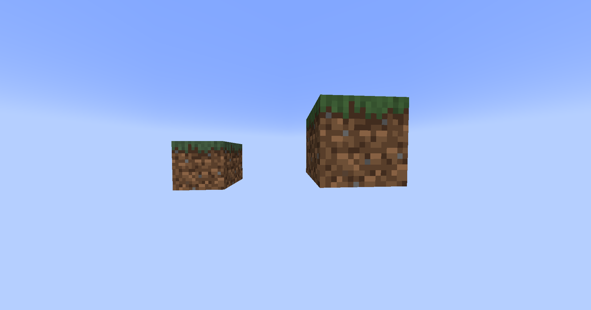
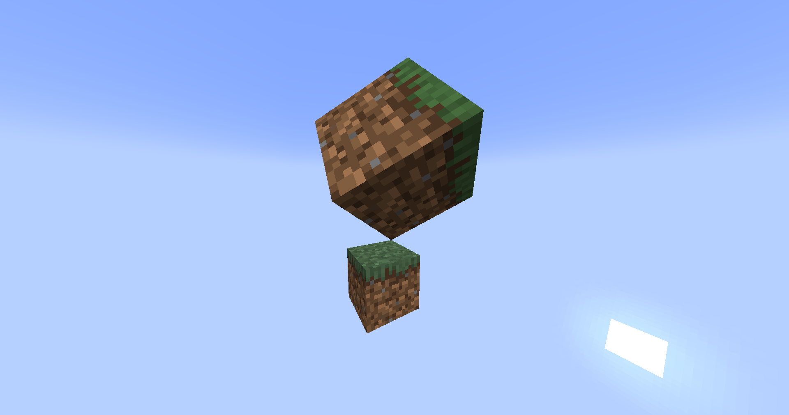
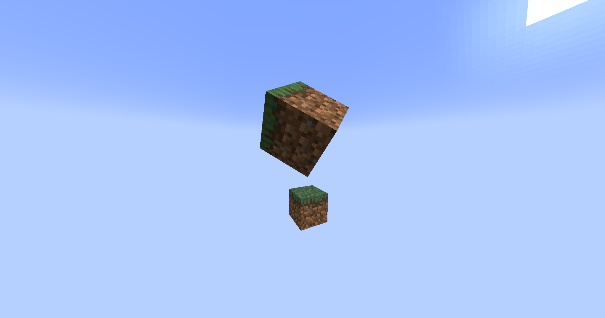
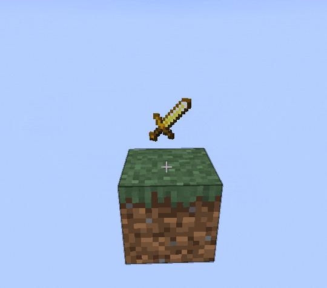

Agregadas en 1.19.4, [mostrar entidades](https://minecraft.wiki/w/Display) son una forma poderosa de mostrar varias cosas en el mundo, como bloques, elementos y texto.

Por defecto, estas entidades no tienen hitbox, no se mueven, no emiten sonidos ni reciben daños, lo que las hace perfectas para todo tipo de aplicaciones, como hologramas.

## Tipos

### Texto

El texto se puede mostrar a través de una entidad [](jd:paper:org.bukkit.entity.TextDisplay).
```java
TextDisplay display = world.spawn(location, TextDisplay.class, entity -> {
    // ¡Personaliza la entidad!
    entity.text(Component.text("Some awesome content", NamedTextColor.BLACK));
    entity.setBillboard(Display.Billboard.VERTICAL); // gira solo sobre el eje vertical
    entity.setBackgroundColor(Color.RED); // hace que el fondo sea rojo

    // Consulta la documentación de Display y TextDisplay: hay muchas más opciones.
});
```
### Bloques

Los bloques se pueden mostrar a través de una entidad [](jd:paper:org.bukkit.entity.BlockDisplay).
```java
BlockDisplay display = world.spawn(location, BlockDisplay.class, entity -> {
    // ¡Personaliza la entidad!
    entity.setBlock(Material.GRASS_BLOCK.createBlockData());
});
```
### Artículos

Los elementos se pueden mostrar a través de una entidad [](jd:paper:org.bukkit.entity.ItemDisplay).

A pesar de su nombre, una visualización de _elemento_ también puede mostrar _bloques_, con la diferencia de que es la posición en el modelo: una visualización de elemento tiene su posición en el centro, mientras que una visualización de bloque tiene su posición en la esquina del bloque (esto se puede ver con el modo de depuración de hitbox - F3+B).
```java
ItemDisplay display = world.spawn(location, ItemDisplay.class, entity -> {
    // ¡Personaliza la entidad!
    entity.setItemStack(ItemStack.of(Material.SKELETON_SKULL));
});
```
## Transformación

A las pantallas se les puede aplicar una transformación afín arbitraria, lo que le permite posicionarlas y deformarlas como desee en el espacio 3D.

Las transformaciones se aplican a la pantalla en este orden:
```d2
style.fill: transparent
direction: right

Translation -> "Left rotation"
"Left rotation" -> Scale
Scale -> "Right rotation"
```

:::tip[Visualizando transformaciones]
Utilice el sitio web [Visualizador de transformación](https://misode.github.io/transformation/) para visualizar una transformación y crear prototipos rápidamente.
:::
### Escala

La transformación más básica es la ampliación. Tomemos un bloque de césped y ampliémoslo:
```java
world.spawn(location, BlockDisplay.class, entity -> {
    entity.setBlock(Material.GRASS_BLOCK.createBlockData());
    entity.setTransformation(
        new Transformation(
                new Vector3f(), // no translation
                new AxisAngle4f(), // no left rotation
                new Vector3f(2, 2, 2), // scale up by a factor of 2 on all axes
                new AxisAngle4f() // no right rotation
        )
    );
    // o establece una matriz de transformación sin procesar de JOML.
    // entity.setTransformationMatrix(
    //         new Matrix4f()
    //                 .scale(2) // Aumenta la escala al doble en todos los ejes.
    // );
});
```


### Rotación

También puedes rotarlo, inclinémoslo hacia su esquina:
```java {6, 8, 15-19}
world.spawn(location, BlockDisplay.class, entity -> {
    entity.setBlock(Material.GRASS_BLOCK.createBlockData());
    entity.setTransformation(
        new Transformation(
                new Vector3f(), // no translation
                new AxisAngle4f((float) -Math.toRadians(45), 1, 0, 0), // rota -45 grados sobre el eje X
                new Vector3f(2, 2, 2), // scale up by a factor of 2 on all axes
                new AxisAngle4f((float) Math.toRadians(45), 0, 0, 1) // rota +45 grados sobre el eje Z
        )
    );
    // o establece una matriz de transformación sin procesar de JOML.
    // entity.setTransformationMatrix(
    //         new Matrix4f()
    //                 .scale(2) // Aumenta la escala al doble en todos los ejes.
    //                 .rotateXYZ(
    //                         (float) Math.toRadians(360 - 45), // Gira -45 grados en el eje X.
    //                         0,
    //                         (float) Math.toRadians(45) // Gira +45 grados en el eje Z.
    //                 )
    // );
});
```


### Traducción

Finalmente, también podemos aplicar una transformación de traducción (desplazamiento de posición) a la visualización, por ejemplo:
```java {5, 14}
world.spawn(location, BlockDisplay.class, entity -> {
    entity.setBlock(Material.GRASS_BLOCK.createBlockData());
    entity.setTransformation(
        new Transformation(
                new Vector3f(0.5F, 0.5F, 0.5F), // offset by half a block on all axes
                new AxisAngle4f((float) -Math.toRadians(45), 1, 0, 0), // rota -45 grados sobre el eje X
                new Vector3f(2, 2, 2), // scale up by a factor of 2 on all axes
                new AxisAngle4f((float) Math.toRadians(45), 0, 0, 1) // rota +45 grados sobre el eje Z
        )
    );
    // o establece una matriz de transformación sin procesar de JOML.
    // entity.setTransformationMatrix(
    //         new Matrix4f()
    //                 .translate(0.5F, 0.5F, 0.5F) // Desplaza medio bloque en todos los ejes.
    //                 .scale(2) // Aumenta la escala al doble en todos los ejes.
    //                 .rotateXYZ(
    //                         (float) Math.toRadians(360 - 45), // Gira -45 grados en el eje X.
    //                         0,
    //                         (float) Math.toRadians(45) // Gira +45 grados en el eje Z.
    //                 )
    // );
});
```


## Interpolación

El cliente puede interpolar linealmente las transformaciones y los teletransportes para crear una animación fluida, cambiando de una transformación/ubicación a la siguiente.

### Transformación

Un ejemplo de esto sería rotar suavemente un bloque/elemento/texto en su lugar. En conjunto con la [API del Programador](/es/paper/dev/scheduler), la animación se puede reiniciar una vez terminada, haciendo que la pantalla gire indefinidamente:
```java
ItemDisplay display = location.getWorld().spawn(location, ItemDisplay.class, entity -> {
    entity.setItemStack(ItemStack.of(Material.GOLDEN_SWORD));
});

int duration = 5 * 20; // duration of half a revolution (5 * 20 ticks = 5 seconds)

Matrix4f mat = new Matrix4f().scale(0.5F); // scale to 0.5x - smaller item
Bukkit.getScheduler().runTaskTimer(plugin, task -> {
    if (!display.isValid()) { // la entidad display se eliminó del mundo; cancela la tarea
        task.cancel();
        return;
    }

    display.setTransformationMatrix(mat.rotateY(((float) Math.toRadians(180)) + 0.1F /* prevent the client from interpolating in reverse */));
    display.setInterpolationDelay(0); // sin retraso para la interpolación
    display.setInterpolationDuration(duration); // establece la duración de la rotación interpolada
}, 1 /* delay the initial transformation by one tick from display creation */, duration);
```
<span class="img-inline-center"></span>

### Teletransportación

De manera similar a la interpolación de transformación, es posible que también desee interpolar el movimiento de toda la entidad de visualización entre dos puntos.

Se puede lograr un efecto similar usando una traducción interpolada; sin embargo, si cambia otras propiedades de la transformación, esas también se interpolarán, lo que puede ser lo que desea o no.
```java
// La nueva posición estará 10 bloques más arriba.
Location newLocation = display.getLocation().add(0, 10, 0);

display.setTeleportDuration(20 * 2); // el movimiento tardará 2 segundos (1 segundo = 20 ticks)
display.teleport(newLocation); // realiza el movimiento
```
## Casos de uso

Las pantallas tienen muchos casos de uso diferentes, que van desde decoración estacionaria hasta animaciones complejas.

Un caso de uso simple y popular es crear una decoración que sea visible solo para jugadores específicos, lo que se puede lograr usando la API de entidad estándar: [`Entity#setVisibleByDefault()`](jd:paper:org.bukkit.entity.Entity#setVisibleByDefault(boolean)) y [`Player#showEntity()`](jd:paper:org.bukkit.entity.Player#showEntity(org.bukkit.plugin.Plugin,org.bukkit.entity.Entity))/ [`Player#hideEntity()`](jd:paper:org.bukkit.entity.Player#hideEntity(org.bukkit.plugin.Plugin,org.bukkit.entity.Entity)).
:::caution
Si la pantalla solo se usa temporalmente, su persistencia se puede desactivar con [`Entity#setPersistent()`](jd:paper:org.bukkit.entity.Entity#setPersistent(boolean)), lo que significa que desaparecerá cuando se descargue el fragmento.

_Sin embargo, si la pantalla está ubicada en un fragmento que nunca se descarga, es decir, un fragmento de generación, nunca se eliminará, lo que creará una fuga de recursos. Asegúrese de quitar la pantalla después con [](jd:paper:org.bukkit.entity.Entity#remove())._
:::
También se pueden agregar como pasajeros a entidades con los métodos [`Entity#addPassenger()`](jd:paper:org.bukkit.entity.Entity#addPassenger(org.bukkit.entity.Entity))/ [`Entity#removePassenger()`](jd:paper:org.bukkit.entity.Entity#removePassenger(org.bukkit.entity.Entity)), útiles para crear etiquetas de nombre con estilo.
```java
TextDisplay display = world.spawn(location, TextDisplay.class, entity -> {
    // ...

    entity.setVisibleByDefault(false); // la oculta para todos
    entity.setPersistent(false); // no guarda la entidad display; es temporal
});

entity.addPassenger(display); // mount it on top of an entity's head
player.showEntity(plugin, display); // show it to a player
// ...
display.remove(); // termina con la entidad display
```
