import { Tabs, TabItem, Badge } from "@astrojs/starlight/components";
import NoteParticleColorPicker from "/src/components/tools/NoteParticleColorPicker.svelte";

Esta guía explica cómo generar diferentes tipos de partículas.

Si la partícula que estás intentando generar no se menciona en esta guía, lo más probable es que no tenga un comportamiento especial.

Hay dos formas de generar partículas. La primera opción es usar la clase [](jd:paper:com.destroystokyo.paper.ParticleBuilder), que se prefiere a los métodos `spawnParticle()`. Es reutilizable y ofrece legibilidad y claridad mejoradas. El constructor también incluye el método [`receivers()`](jd:paper:com.destroystokyo.paper.ParticleBuilder#receivers()), que le proporciona un mayor control sobre los receptores.

Un ejemplo de cómo generar 14 partículas de notas en un cuboide de 4x0,4x4:
```java
Particle.NOTE.builder()
    .location(someLocation)
    .offset(2, 0.2, 2)
    .count(14)
    .receivers(32, true)
    .spawn();
```

:::note
El uso de [`ParticleBuilder.receivers(32, true)`](jd:paper:com.destroystokyo.paper.ParticleBuilder#receivers(int,boolean)) selecciona a todos los jugadores en una distancia de 32 bloques desde la ubicación de la partícula, lo que da como resultado una forma de esfera. Establecer el parámetro booleano en `false` seleccionaría a todos los jugadores en un cubo.
:::
La segunda forma es utilizar los métodos `spawnParticle()` en las clases `World` y `Player`:
- [`World.spawnParticle()`](jd:paper:org.bukkit.World#spawnParticle(org.bukkit.Particle,double,double,double,int)) que genera la partícula para todos los jugadores y
- [`Player.spawnParticle()`](jd:paper:org.bukkit.entity.Player#spawnParticle(org.bukkit.Particle,double,double,double,int)) que genera la partícula solo para el jugador.

## `count` comportamiento del argumento <Badge variant="danger" text="Importante" size="large" />
Al generar partículas, el cliente de Minecraft se comporta de manera diferente según el argumento `count`:
- Si es `count = 0`, se genera una partícula singular y el cliente usa la ubicación proporcionada sin modificaciones.
Los valores de compensación se multiplican por el argumento `extra` y se pasan al constructor de partículas. La forma en que se utilizan estos valores puede variar según los tipos de partículas.

- Si es `count > 0`, el cliente genera `count` número de partículas. Para cada partícula, genera un nuevo desplazamiento.
valores usando una distribución gaussiana (normal), los multiplica por el argumento `extra` y los pasa al constructor de partículas.

## Partículas direccionales
Este tipo de partícula tiene una velocidad inicial cuando se genera.
:::note
La velocidad efectiva varía entre partículas.
:::
En el siguiente ejemplo, se generan aleatoriamente 8 partículas `FLAME` en forma de cubo de 1x1x1. `someLocation` sirve como su centro. El argumento `extra` se establece en 0, por lo que las partículas no se mueven.
<Tabs syncKey="spawn-type">
  <TabItem label="ParticleBuilder">
    ```java
    Particle.FLAME.builder()
        .location(someLocation)
        .offset(0.5, 0.5, 0.5)
        .count(8)
        .extra(0)
        .receivers(32, true)
        .spawn();
    ```
</TabItem>
  <TabItem label="spawnParticle">
    ```java
    someWorld.spawnParticle(Particle.FLAME, someLocation, 8, 0.5, 0.5, 0.5, 0);
    ```
</TabItem>
</Tabs>
:::caution
Si deja el parámetro `extra` sin configurar, se establecerá de forma predeterminada en `1`, lo que probablemente provocará un comportamiento inesperado.
:::
### Dirección aleatoria
Establecer el parámetro `count` en cualquier valor positivo producirá una dirección aleatoria para la velocidad como se describe en [`count` comportamiento del argumento](#count-argument-behavior).

Un ejemplo de generación de 6 partículas `CRIT` en una ubicación, sin desplazamiento, que se moverán en una dirección aleatoria a una velocidad moderada:
<Tabs syncKey="spawn-type">
  <TabItem label="ParticleBuilder">
    ```java
    Particle.CRIT.builder()
        .location(someLocation)
        .count(6)
        .extra(0.6)
        .receivers(32, true)
        .spawn();
    ```
</TabItem>
  <TabItem label="spawnParticle">
    ```java
    someWorld.spawnParticle(Particle.CRIT, someLocation, 6, 0, 0, 0, 0.6);
    ```
</TabItem>
</Tabs>

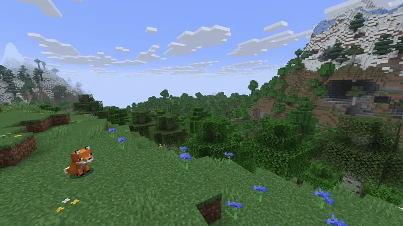

### Dirección especificada
Para especificar la dirección de la velocidad, establezca el argumento `count` en `0` y utilice los argumentos de desplazamiento como vector de dirección. Consulte [`count` comportamiento del argumento](#count-argument-behavior) para obtener más detalles.

Un ejemplo de una tarea repetitiva que genera humo de fogata que "sube" lentamente (eje Y positivo):
<Tabs syncKey="spawn-type">
  <TabItem label="ParticleBuilder">
    ```java
    ParticleBuilder particleBuilder = Particle.CAMPFIRE_SIGNAL_SMOKE.builder()
        .location(someLocation)
        .offset(0, 1, 0)
        .count(0)
        .extra(0.1);

    Bukkit.getScheduler().runTaskTimer(plugin, () -> {
        particleBuilder.receivers(32, true).spawn();
    }, 0, 4);
    ```
</TabItem>
  <TabItem label="spawnParticle">
    ```java
    Bukkit.getScheduler().runTaskTimer(plugin, () -> {
        someWorld.spawnParticle(Particle.CAMPFIRE_SIGNAL_SMOKE, someLocation, 0, 0, 1, 0, 0.1);
    }, 0, 4);
    ```
</TabItem>
</Tabs>

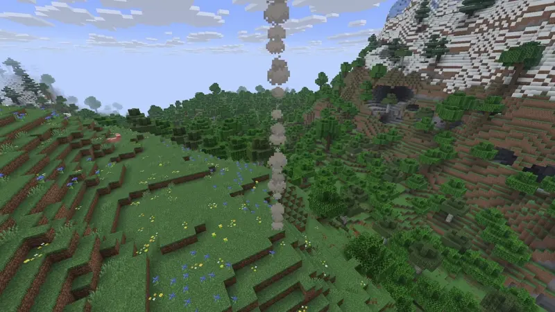

También podríamos hacer que el humo bajara si quisiéramos:
<Tabs syncKey="spawn-type">
  <TabItem label="ParticleBuilder">
    ```java
    ParticleBuilder particleBuilder = Particle.CAMPFIRE_SIGNAL_SMOKE.builder()
        .location(someLocation)
        .offset(0, -1, 0)
        .count(0)
        .extra(0.1);

    Bukkit.getScheduler().runTaskTimer(plugin, () -> {
        particleBuilder.receivers(32, true).spawn();
    }, 0, 4);
    ```
</TabItem>
  <TabItem label="spawnParticle">
    ```java
    Bukkit.getScheduler().runTaskTimer(plugin, () -> {
        someWorld.spawnParticle(Particle.CAMPFIRE_SIGNAL_SMOKE, someLocation, 0, 0, -1, 0, 0.1);
    }, 0, 4);
    ```
</TabItem>
</Tabs>

### Lista de partículas direccionales
{/* spellchecker:off */}
<details>
  <summary>Mostrar lista</summary>
  - BLOQUEAR
  - BURBUJA
  - BUBBLE_COLUMN_UP
  -BURBUJA_POP
  - CAMPFIRE_COSY_SMOKE
  - CAMPFIRE_SIGNAL_SMOKE
  - NUBE
  - CRÍTICO
  - DAÑO_INDICATOR
  - DRAGON_BREATH
  - POLVO
  - POLVO_COLOR_TRANSICIÓN
  - PLUME_POLVO
  - CHISPA ELÉCTRICA
  - GOLPE_ENCANTADO
  -END_ROD
  - FUEGOS ARTIFICIALES
  - PESCA
  - LLAMA
  - DESTELLO
  -GEYSER_BASE
  - GEYSER_POOF
  - GEYSER_PLUME
  - GLOW_SQUID_INK
  - ARTÍCULO
  - GRANDE_HUMO
  - PAUSE_MOB_GROWTH
  - PUF
  -RESET_MOB_GROWTH
  -PORTAL_REVERSO
  - RASPAR
  -SCULK_CHARGE
  -SCULK_CHARGE_POP
  -SCULK_SOUL
  - PEQUEÑA_LLAMA
  - FUMAR
  - ESTORNUDAR
  - COPO DE NIEVE
  - ALMA
  - ALMA_FUEGO_LLAMA
  - ESCUPIR
  - TINTA DE CALAMAR
  -TOTEM_OF_UNDYING
  - TRIAL_SPAWNER_DETECTION
  - TRIAL_SPAWNER_DETECTION_OMINOUS
  - CERA_APAGADO
  - CERA_ON
  - HUMO_BLANCO
</details>
{/* spellchecker:on */}

## Partículas de colores
Estas partículas se pueden colorear pasando un objeto [](jd:paper:org.bukkit.Color) como argumento `data`.

Ejemplo de cómo generar 10 partículas de efecto de poción en un área de 2x2x2 con un color naranja ligeramente translúcido:
<Tabs syncKey="spawn-type">
  <TabItem label="ParticleBuilder">
    ```java
    Particle.ENTITY_EFFECT.builder()
        .location(someLocation)
        .offset(1, 1, 1)
        .count(10)
        .data(Color.fromARGB(200, 255, 128, 0))
        .receivers(32, true)
        .spawn();
    ```
</TabItem>
  <TabItem label="spawnParticle">
    ```java
    someWorld.spawnParticle(Particle.ENTITY_EFFECT, someLocation, 10, 1, 1, 1, Color.fromARGB(200, 255, 128, 0));
    ```
</TabItem>
</Tabs>

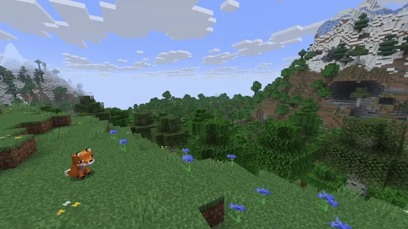
:::note
Sólo la partícula `ENTITY_EFFECT` soporta el canal alfa, que se utiliza para crear partículas translúcidas.
:::

:::caution
Mientras que las partículas `FLASH` y `TINTED_LEAVES` toman un color ARGB, el canal alfa se ignora.
:::
### Polvo
Vanilla usa la partícula de polvo para las partículas de piedra roja. Pueden tener un color personalizado pasando [](jd:paper:org.bukkit.Particle$DustOptions) como `data`.
:::note
El factor de escala debe estar en el rango de `0.01` a `4.0`. Los valores fuera de este rango se limitarán al valor válido más cercano.
:::
Un ejemplo de cómo crear una línea vertical de partículas de polvo azul, que son dos veces el tamaño normal:
<Tabs syncKey="spawn-type">
  <TabItem label="ParticleBuilder">
    ```java
    ParticleBuilder particleBuilder = Particle.DUST.builder()
        .color(Color.BLUE, 2.0F);

    // Podemos reutilizar el constructor.
    for (double i = -1.0; i <= 1.0; i += 0.25) {
        particleBuilder.location(someLocation.clone().add(0, i, 0)).receivers(32, true).spawn();
    }
    ```
</TabItem>
  <TabItem label="spawnParticle">
    ```java
    for (double i = -1.0; i <= 1.0; i += 0.25) {
        someWorld.spawnParticle(
            Particle.DUST,
            someLocation.clone().add(0, i, 0),
            1,
            new Particle.DustOptions(Color.BLUE, 2.0F)
        );
    }
    ```
</TabItem>
</Tabs>

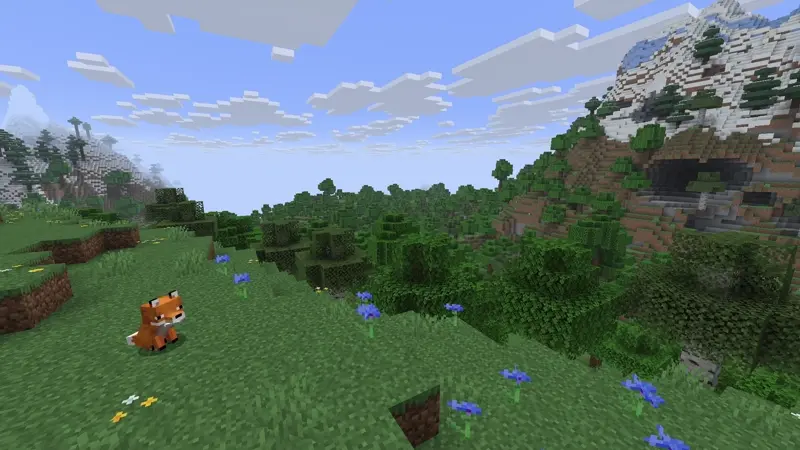
:::note
Aquí, agregar un argumento de tamaño controlaría la vida útil de la partícula de polvo, en ticks. De forma predeterminada, el valor es un número entero aleatorio entre 8 y 40, que se multiplica por la escala de la partícula para obtener la vida útil final (con un mínimo de 1).
:::
### Transición de polvo
Las partículas de transición de polvo funcionan exactamente como [partículas de polvo](#dust), pero en lugar de tener un color estático, **cambian** su color de una a otra. Se utiliza un [](jd:paper:org.bukkit.Particle$DustTransition) para especificar la transición.

Un ejemplo en el que se generan tres partículas de transición de polvo en el eje x dentro de una longitud de 1 bloque:
<Tabs syncKey="spawn-type">
  <TabItem label="ParticleBuilder">
    ```java
    Particle.DUST_COLOR_TRANSITION.builder()
        .location(someLocation)
        .offset(0.5, 0, 0)
        .count(3)
        .colorTransition(Color.RED, Color.BLUE)
        .receivers(32, true)
        .spawn();
    ```
</TabItem>
  <TabItem label="spawnParticle">
    ```java
    someWorld.spawnParticle(
        Particle.DUST_COLOR_TRANSITION,
        someLocation,
        3,
        0.5, 0, 0,
        new Particle.DustTransition(Color.RED, Color.BLUE, 1.0F)
    );
    ```
</TabItem>
</Tabs>

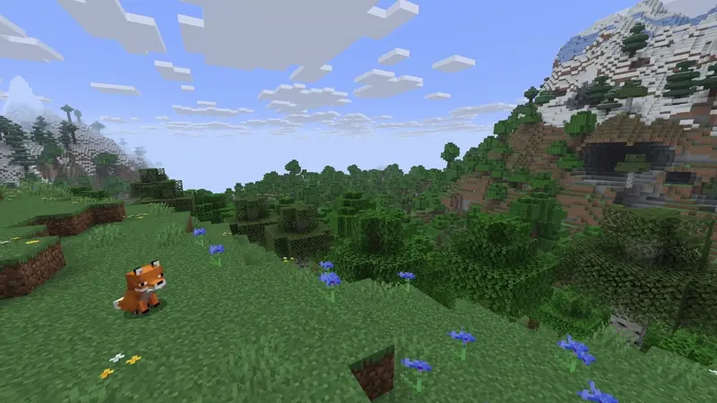

### Nota
Las partículas de notas utilizarán el argumento `offsetX` en una función personalizada para determinar el color; consulte [Selector de color de partículas de notas](#note-particle-color-picker) para obtener más detalles. En este caso se ignoran `offsetY` y `offsetZ`.

Ejemplo:
<Tabs syncKey="spawn-type">
  <TabItem label="ParticleBuilder">
    ```java
    Particle.NOTE.builder()
        .location(someLocation)
        .offset(0.4F, 0, 0)
        .count(0)
        .receivers(32, true)
        .spawn();
    ```
</TabItem>
  <TabItem label="spawnParticle">
    ```java
    someWorld.spawnParticle(Particle.NOTE, someLocation, 0, 0.4F, 0, 0);
    ```
</TabItem>
</Tabs>

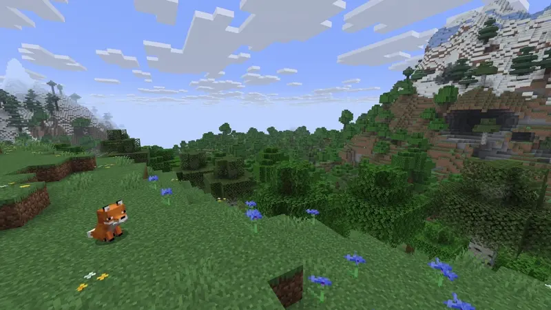

#### Selector de color de partículas de notas
Esta herramienta le permite elegir un color para la partícula de nota ajustando el valor `offsetX`. Sólo permite elegir valores de `offsetX` entre `-1.0` y `1.0`; los valores fuera de este rango repetirán el patrón de color.
<NoteParticleColorPicker client:load />
:::tip
Para lograr los colores de las partículas de notas de vainilla, debes establecer el desplazamientoX en una fracción de 24.

Ejemplo:
<Tabs syncKey="spawn-type">
  <TabItem label="ParticleBuilder">
    ```java
    Particle.NOTE.builder()
        .location(someLocation)
        .offset(2.0F / 24.0F, 0, 0)
        .count(0)
        .receivers(32, true)
        .spawn();
    ```
</TabItem>
  <TabItem label="spawnParticle">
    ```java
    someWorld.spawnParticle(Particle.NOTE, someLocation, 0, 2.0F / 24.0F, 0, 0);
    ```
</TabItem>
</Tabs>
:::
### Sendero
Las partículas del rastro requieren que pases un objeto [](jd:paper:org.bukkit.Particle$Trail) como `data`.

Un ejemplo en el que ocho partículas de rastro desplazadas aleatoriamente viajan hacia una ubicación específica (`someLocation.clone().add(-4, 0, 4)`) con un color amarillo y un tiempo de viaje de 40 ticks:
<Tabs syncKey="spawn-type">
  <TabItem label="ParticleBuilder">
    ```java
    Particle.TRAIL.builder()
        .location(someLocation)
        .offset(1, 1, 1)
        .count(8)
        .data(new Particle.Trail(someLocation.clone().add(-4, 0, 4), Color.YELLOW, 40))
        .receivers(32, true)
        .spawn();
    ```
</TabItem>
  <TabItem label="spawnParticle">
    ```java
    someWorld.spawnParticle(
        Particle.TRAIL,
        someLocation,
        8,
        1, 1, 1,
        new Particle.Trail(someLocation.clone().add(-4, 0, 4), Color.YELLOW, 40)
    );
    ```
</TabItem>
</Tabs>

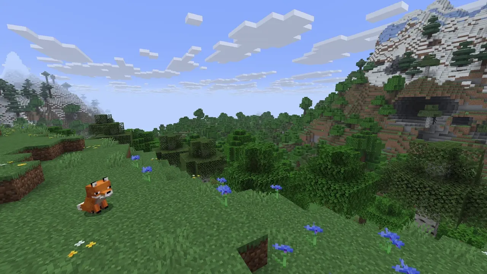

## Partículas convergentes
Como su nombre lo indica, este tipo de partícula converge en un único punto (ubicación), que en este caso es la ubicación suministrada. Los argumentos de compensación se utilizan para determinar la ubicación relativa de generación de la partícula. Luego, la partícula viajará desde esta ubicación relativa a la ubicación suministrada.

Un ejemplo en el que una partícula de encantamiento se generará en `someLocation.clone().add(-2, 0, 2)` y viajará a `someLocation`:
<Tabs syncKey="spawn-type">
  <TabItem label="ParticleBuilder">
    ```java
    Particle.ENCHANT.builder()
        .location(someLocation)
        .offset(-2, 0, 2)
        .count(0)
        .receivers(32, true)
        .spawn();
    ```
</TabItem>
  <TabItem label="spawnParticle">
    ```java
    someWorld.spawnParticle(Particle.ENCHANT, someLocation, 0, -2, 0, 2);
    ```
</TabItem>
</Tabs>

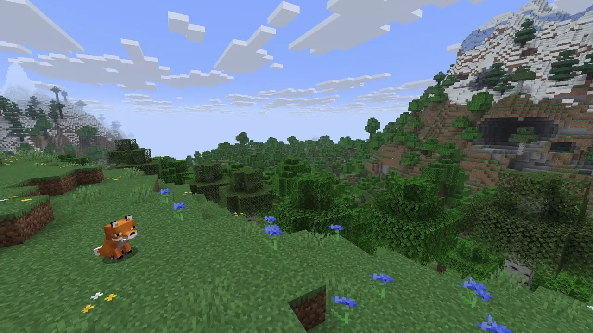
:::note
Hay dos tipos de partículas convergentes:

- **Curva**: Partículas que siguen una trayectoria curva hasta la ubicación especificada.
- **Recta**: Partículas que se mueven en línea recta hasta la ubicación especificada.

Las partículas `ENCHANT`, `NAUTILUS`, `PORTAL` y `VAULT_CONNECTION` utilizan trayectorias curvas, mientras que la partícula `OMINOUS_SPAWNING` viaja en línea recta.
:::
### Lista de partículas convergentes
<details>
  <summary>Mostrar lista</summary>
  - ENCANTAR
  - NAUTILO
  - OMINOUS_SPAWNING
  -PORTAL
  - VAULT_CONNECTION
</details>

## Bloquear partículas
Para generar partículas que requieran `BlockData`, simplemente coloque `BlockData` como argumento `data`.

Ejemplo:
<Tabs syncKey="spawn-type">
  <TabItem label="ParticleBuilder">
    ```java
    Particle.BLOCK_CRUMBLE.builder()
        .location(someLocation)
        .count(4)
        .data(BlockType.GLOWSTONE.createBlockData())
        .receivers(32, true)
        .spawn();
    ```
</TabItem>
  <TabItem label="spawnParticle">
    ```java
    someWorld.spawnParticle(Particle.BLOCK_CRUMBLE, someLocation, 4, BlockType.GLOWSTONE.createBlockData());
    ```
</TabItem>
</Tabs>
:::note
Esta guía utiliza [](jd:paper:org.bukkit.block.BlockType#createBlockData()). Si bien el uso de [](jd:paper:org.bukkit.Material#createBlockData()) o [](jd:paper:org.bukkit.Bukkit#createBlockData(org.bukkit.Material)) produce el mismo resultado, se consideran **heredados**.
:::

:::tip
La partícula `BLOCK` es una [partícula direccional](#directional-particles).

En este caso, **la velocidad importa** mucho. Una velocidad más alta asegurará la misma dirección general de la partícula, mientras que una velocidad más baja dará como resultado una dirección más aleatoria.

Para lograr esto, la longitud del vector de velocidad efectiva debe ser alta (alrededor de 10 está bien).
:::
## Partículas del artículo
Para generar partículas que requieran un `ItemStack`, simplemente coloque un `ItemStack` como argumento `data`.

Ejemplo:
<Tabs syncKey="spawn-type">
  <TabItem label="ParticleBuilder">
    ```java
    Particle.ITEM.builder()
        .location(someLocation)
        .count(4)
        .data(ItemStack.of(Material.DIAMOND_PICKAXE))
        .receivers(32, true)
        .spawn();
    ```
</TabItem>
  <TabItem label="spawnParticle">
    ```java
    someWorld.spawnParticle(Particle.ITEM, someLocation, 4, ItemStack.of(Material.DIAMOND_PICKAXE));
    ```
</TabItem>
</Tabs>
:::note
Esta guía utiliza [](jd:paper:org.bukkit.inventory.ItemStack#of(org.bukkit.Material)). Si bien el uso de [`new ItemStack(Material)`](jd:paper:org.bukkit.inventory.ItemStack) produce el mismo resultado, se considera **heredado**. [](jd:paper:org.bukkit.inventory.ItemType#createItemStack()) también produce el mismo resultado, pero es más probable que se elimine en el futuro.
:::

:::tip
La partícula `ITEM` es una [partícula direccional](#directional-particles).
:::
## Partículas de esculpir
### Carga de Sculk
La partícula `SCULK_CHARGE` toma un `float` como argumento `data`. Esto se utiliza como "rollo" de la partícula. O, más formalmente, el ángulo en el que se muestra la partícula en **radianes**.

Ejemplo de generación de una partícula de carga sculk a 45° que no se mueve:
<Tabs syncKey="spawn-type">
  <TabItem label="ParticleBuilder">
    ```java
    Particle.SCULK_CHARGE.builder()
        .location(someLocation)
        .data((float) Math.toRadians(45))
        .extra(0)
        .receivers(32, true)
        .spawn();
    ```
</TabItem>
  <TabItem label="spawnParticle">
    ```java
    someWorld.spawnParticle(Particle.SCULK_CHARGE, someLocation, 1, 0, 0, 0, 0, (float) Math.toRadians(45));
    ```
</TabItem>
</Tabs>

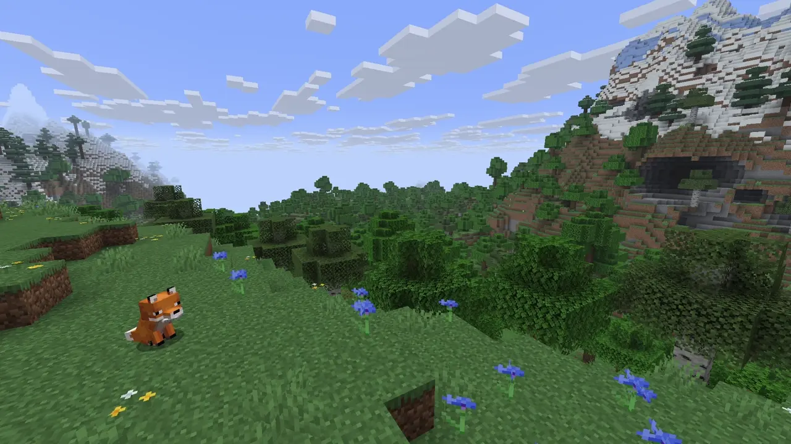
:::tip
La partícula `SCULK_CHARGE` es una [partícula direccional](#directional-particles).
:::
### Grito
La partícula `SHRIEK` toma un `integer` como argumento `data`. Esto se utiliza para establecer el retraso **en ticks** antes de que se genere la partícula.

Depende completamente de su implementación elegir usar `data` o un programador.

Ejemplo en el que se generará una partícula de chillido después de un segundo:
<Tabs syncKey="spawn-type">
  <TabItem label="ParticleBuilder">
    ```java
    Particle.SHRIEK.builder()
        .location(someLocation)
        .data(20)
        .receivers(32, true)
        .spawn();
    ```
</TabItem>
  <TabItem label="spawnParticle">
    ```java
    someWorld.spawnParticle(Particle.SHRIEK, someLocation, 1, 20);
    ```
</TabItem>
</Tabs>

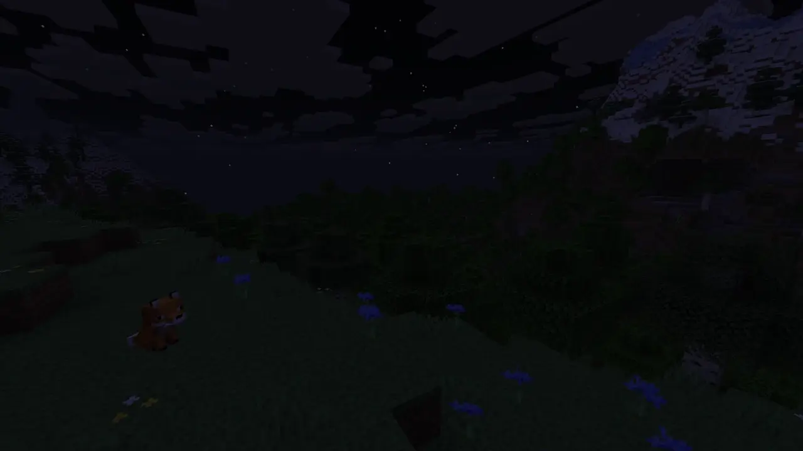

### Vibración
Las partículas de vibración requieren que pases un objeto [](jd:paper:org.bukkit.Vibration) como `data`, donde puedes elegir entre una ubicación ([](jd:paper:org.bukkit.Vibration$Destination$BlockDestination)) o una entidad objetivo ([](jd:paper:org.bukkit.Vibration$Destination$EntityDestination)). El segundo argumento del constructor es el tiempo de viaje en **ticks**.

Un ejemplo en el que una partícula vibratoria se generará en `someLocation` y viajará a `otherLocation` en 40 ticks:
<Tabs syncKey="spawn-type">
  <TabItem label="ParticleBuilder">
    ```java
    Particle.VIBRATION.builder()
        .location(someLocation)
        .data(new Vibration(new Vibration.Destination.BlockDestination(otherLocation), 40))
        .receivers(32, true)
        .spawn();
    ```
</TabItem>
  <TabItem label="spawnParticle">
    ```java
    someWorld.spawnParticle(
        Particle.VIBRATION,
        someLocation,
        1,
        new Vibration(new Vibration.Destination.BlockDestination(otherLocation), 40)
    );
    ```
</TabItem>
</Tabs>

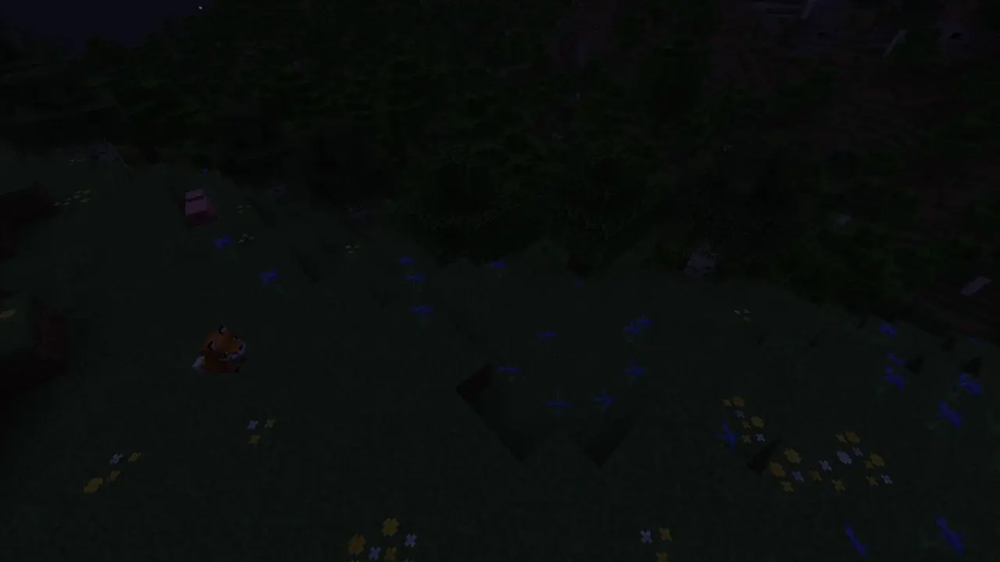

## Partículas ascendentes
Estas partículas utilizarán `offsetY` como velocidad del eje y de la partícula.

Si configura `offsetX` Y `offsetZ` en `0`, la partícula casi no tendrá velocidad en el eje x o z, pero aún tendrá una velocidad en el eje y establecida por el argumento `offsetY`. En ambos casos, `offsetX` y `offsetZ` no se utilizan en el vector de velocidad.
:::caution
`EFFECT` y `INSTANT_EFFECT` son [partículas energizadas](#powered-particles) y utilizan [](jd:paper:org.bukkit.Particle$Spell) como datos. Debido a que la naturaleza de la velocidad vertical final calculada de las partículas ascendentes es muy baja (en el rango \[-0.056, 0.056\]) y a cómo las partículas impulsadas calculan la velocidad vertical, la velocidad vertical resultante siempre será la opuesta al signo del valor `power`.
:::
Ejemplo de generación de una partícula `GLOW` que se mueve hacia arriba:
<Tabs syncKey="spawn-type">
  <TabItem label="ParticleBuilder">
    ```java
    Particle.GLOW.builder()
        .location(someLocation)
        .count(0)
        .offset(0, 2, 0)
        .receivers(32, true)
        .spawn();
    ```
</TabItem>
  <TabItem label="spawnParticle">
    ```java
    someWorld.spawnParticle(Particle.GLOW, someLocation, 0, 0, 2, 0);
    ```
</TabItem>
</Tabs>

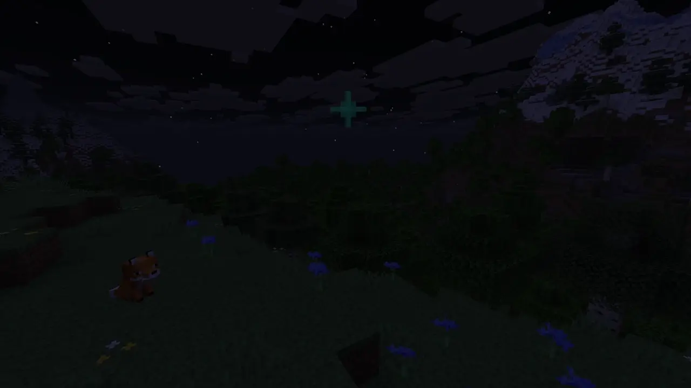
:::note
Estas partículas se elevan, lo que significa que la velocidad inicial se utilizará sólo brevemente y la partícula comenzará a ascender después de un corto tiempo. Por lo tanto, una velocidad vertical negativa solo impedirá que la partícula ascienda temporalmente, mientras que una velocidad vertical positiva hará que la partícula ascienda inmediatamente.
:::
### Lista de partículas ascendentes
<details>
  <summary>Mostrar lista</summary>
  - EFECTO
  - ENTIDAD_EFECTO
  - BRILLO
  - INFESTADO
  - EFECTO_INSTANTÁNEO
  -RAID_OMEN
  - PRUEBA_OMEN
  - BRUJA
</details>

## Partículas escalables
Estas partículas se pueden escalar con `offsetX`, mientras que `offsetY` y `offsetZ` se ignoran. Este capítulo no incluye partículas de polvo; esas partículas se tratan en los capítulos [Partículas de polvo](#dust) y [Partículas de transición de polvo](#dust-transition).
:::note
Si la escala calculada final es negativa, la partícula aparecerá reflejada.
:::
### Ataque de barrido
La escala de la partícula `SWEEP_ATTACK` se calcula como `1.0 - offsetX * 0.5`.

Un ejemplo donde dos partículas de ataque de barrido aparecerán en `someLocation`. El primero con una escala de `1.0` y el segundo con una escala de `2.0` justo después:
<Tabs syncKey="spawn-type">
  <TabItem label="ParticleBuilder">
    ```java
    ParticleBuilder particleBuilder = Particle.SWEEP_ATTACK.builder()
        .location(someLocation)
        .count(0)
        .receivers(32, true)
        .spawn();

    Bukkit.getScheduler().runTaskLater(plugin, () -> {
        particleBuilder.offset(-2, 0, 0).spawn();
    }, 10);
    ```
</TabItem>
  <TabItem label="spawnParticle">
    ```java
    someWorld.spawnParticle(Particle.SWEEP_ATTACK, someLocation, 0);

    Bukkit.getScheduler().runTaskLater(plugin, () -> {
        someWorld.spawnParticle(Particle.SWEEP_ATTACK, someLocation, 0, -2, 0, 0);
    }, 10);
    ```
</TabItem>
</Tabs>

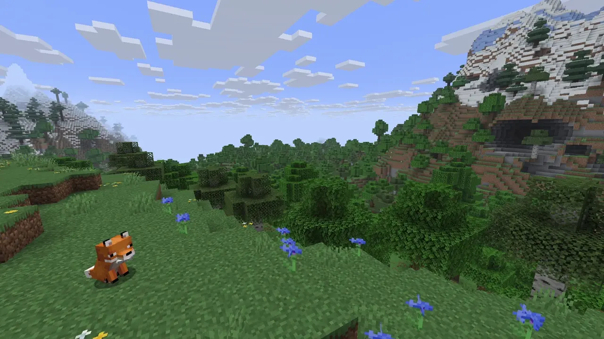

### Explosión
La escala de la partícula `EXPLOSION` se calcula como `2.0 * (1.0 - offsetX * 0.5)`.

Un ejemplo en el que se generarán dos partículas de explosión en `someLocation`. El primero con una escala de `1.0` y el segundo con una escala de `4.0` justo después:
<Tabs syncKey="spawn-type">
  <TabItem label="ParticleBuilder">
    ```java
    ParticleBuilder particleBuilder = Particle.EXPLOSION.builder()
        .location(someLocation)
        .offset(1, 0, 0)
        .count(0)
        .receivers(32, true)
        .spawn();

    Bukkit.getScheduler().runTaskLater(plugin, () -> {
        particleBuilder.offset(-2, 0, 0).spawn();
    }, 10);
    ```
</TabItem>
  <TabItem label="spawnParticle">
    ```java
    someWorld.spawnParticle(Particle.EXPLOSION, someLocation, 0, 1, 0, 0);

    Bukkit.getScheduler().runTaskLater(plugin, () -> {
        someWorld.spawnParticle(Particle.EXPLOSION, someLocation, 0, -2, 0, 0);
    }, 10);
    ```
</TabItem>
</Tabs>

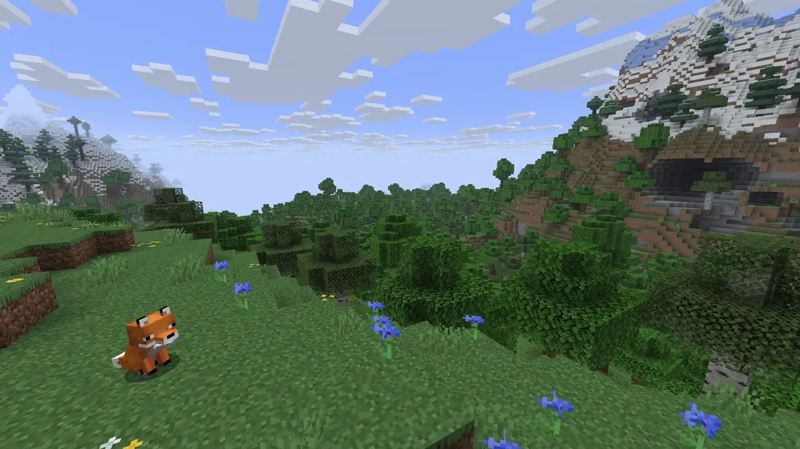

## Partículas de géiser
Hay cuatro partículas de géiser: `GEYSER_BASE`, `GEYSER_POOF`, `GEYSER_PLUME` y `GEYSER`.

### Base y puf
Las partículas `GEYSER_BASE` y `GEYSER_POOF` funcionan de manera idéntica, diferenciándose sólo en apariencia. Utilizan [](jd:paper:org.bukkit.Particle$GeyserBase) como datos.

El tamaño de partícula se calcula como `3.0 + 0.125 * waterBlocks`.

Son [partículas direccionales](#directional-particles), pero también se ven afectadas por los bloques de agua y los parámetros de impulso de explosión. La velocidad inicial se calcula de la siguiente manera:
```
burstImpulse = burstImpulseBase + 0.25 * waterBlocks;

// xd, yd y zd son, respectivamente, las componentes x, y y z de la velocidad de la partícula.
// En este caso, pueden tener un valor inicial distinto de cero.
// xAux, yAux y zAux son, respectivamente, las componentes x, y y z del vector de velocidad proporcionado.
xd = xd * burstImpulse + xAux;
yd = yd * burstImpulse + yAux;
zd = zd * burstImpulse + zAux;

yd = abs(yd);
```

:::note
Los valores iniciales de `xd` y `zd` están en el rango `[-0.1, 0.1]`, mientras que `yd` está en el rango `[0.0, 0.2]`.
:::

:::note
La posición de generación de estas partículas se modifica ligeramente agregando un desplazamiento aleatorio a cada coordenada. Las coordenadas x y z se modifican mediante un valor aleatorio en el rango `[-0.25, 0.25]`, mientras que la coordenada y se modifica mediante un valor aleatorio en el rango `[-0.05, 0.45]`.
:::
Un ejemplo de generación de una partícula base de géiser en `someLocation` con un impulso de explosión de `1` y 1 bloque de agua:
<Tabs syncKey="spawn-type">
  <TabItem label="ParticleBuilder">
    ```java
    Particle.GEYSER_BASE.builder()
        .location(someLocation)
        .count(0)
        .receivers(32, true)
        .data(new Particle.GeyserBase(1, 1))
        .spawn();
    ```
</TabItem>
  <TabItem label="spawnParticle">
    ```java
    someWorld.spawnParticle(Particle.GEYSER_BASE, someLocation, 0, 0, 0, 0, new Particle.GeyserBase(1, 1));
    ```
</TabItem>
</Tabs>

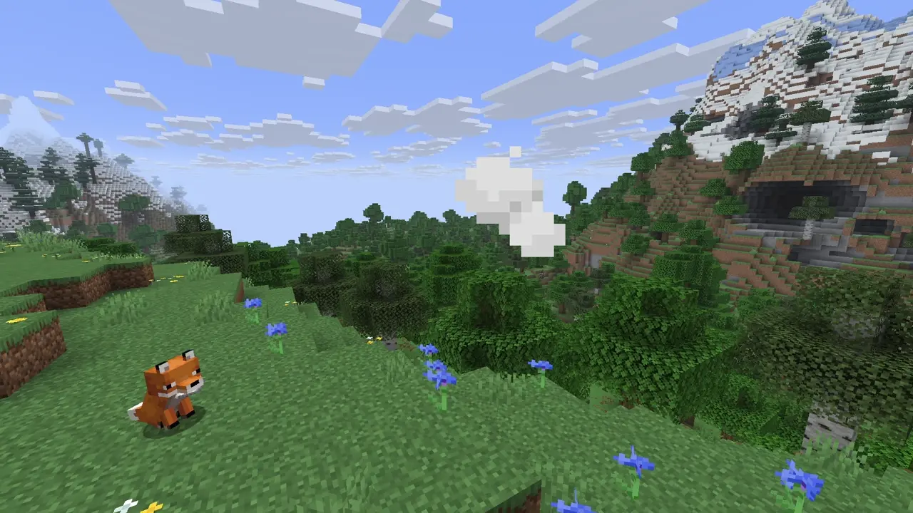

### penacho
La partícula `GEYSER_PLUME` utiliza [](jd:paper:org.bukkit.Particle$Geyser) como datos.

Aunque técnicamente es una [partícula direccional](#directional-particles), la velocidad vertical de esta partícula se establece en `0` y la velocidad horizontal se aplica solo en el primer tic.

La altura de la columna se calcula como `5 * waterBlocks`.
:::note
La posición de generación de estas partículas se modifica ligeramente agregando un desplazamiento aleatorio a cada coordenada. Las coordenadas x y z se modifican mediante un valor aleatorio en el rango `[-0.1, 0.1]`, mientras que la coordenada y se modifica mediante un valor aleatorio en el rango `[0, 1]`.
:::
Un ejemplo de cómo generar una partícula de penacho de géiser en `someLocation` con 1 bloque de agua:
<Tabs syncKey="spawn-type">
  <TabItem label="ParticleBuilder">
    ```java
    Particle.GEYSER_PLUME.builder()
        .location(someLocation)
        .count(0)
        .receivers(32, true)
        .data(new Particle.Geyser(1))
        .spawn();
    ```
</TabItem>
  <TabItem label="spawnParticle">
    ```java
    someWorld.spawnParticle(Particle.GEYSER_PLUME, someLocation, 0, 0, 0, 0, new Particle.Geyser(1));
    ```
</TabItem>
</Tabs>

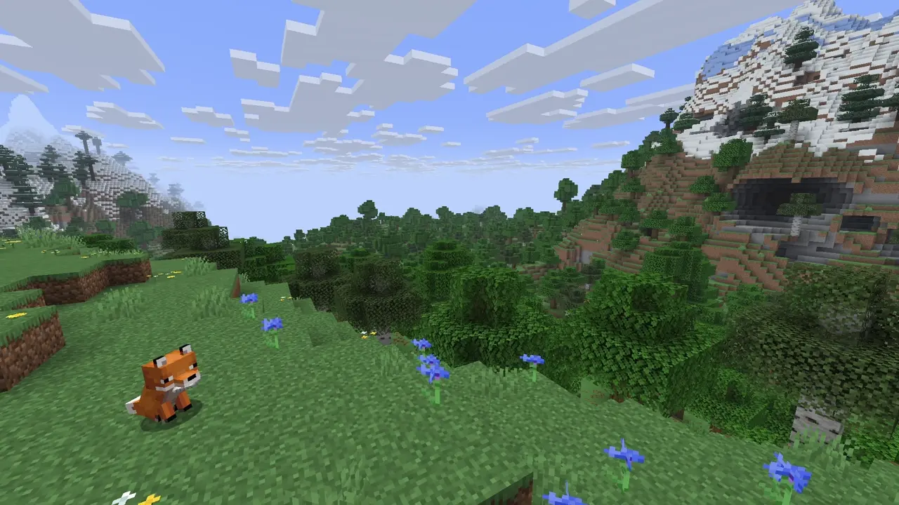

### Emisor
La partícula `GEYSER` es una partícula emisora, lo que significa que genera otras partículas. En este caso, genera todas las partículas de géiser mencionadas anteriormente. El vector de velocidad proporcionado se pasa a las partículas generadas y se utiliza como se describe anteriormente.

Esta partícula utiliza [](jd:paper:org.bukkit.Particle$Geyser) como datos.

La base de impulso de explosión de la partícula base del géiser se establece en `1.5` y la base de impulso de explosión de la partícula de poof se establece en `2.0`.

Un ejemplo de cómo generar una partícula de géiser en `someLocation` con 1 bloque de agua:
<Tabs syncKey="spawn-type">
  <TabItem label="ParticleBuilder">
    ```java
    Particle.GEYSER.builder()
        .location(someLocation)
        .count(0)
        .receivers(32, true)
        .data(new Particle.Geyser(1))
        .spawn();
    ```
</TabItem>
  <TabItem label="spawnParticle">
    ```java
    someWorld.spawnParticle(Particle.GEYSER, someLocation, 0, 0, 0, 0, new Particle.Geyser(1));
    ```
</TabItem>
</Tabs>

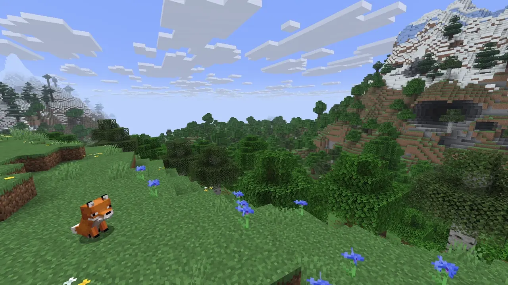

## Comportamientos varios
Este capítulo cubre partículas que tienen comportamientos únicos cuando se reproducen.

### Partículas de aldeanos enojados
La partícula `ANGRY_VILLAGER` siempre genera `0.5` más arriba (eje y) que la ubicación proporcionada.

### Partículas de nubes
Las partículas `CLOUD` y `SNEEZE` se mueven hacia el nivel y del jugador, si están a dos cuadras de distancia de la ubicación del jugador. Cuando alcancen el nivel y del jugador, su velocidad vertical se reducirá considerablemente.

Si el jugador se mueve verticalmente, las partículas intentarán igualar la velocidad vertical del jugador.

### Partículas indicadoras de daño
La partícula `DAMAGE_INDICATOR` agrega `1.0` al `offsetY` proporcionado.

### Partículas del pilar de polvo
La partícula `DUST_PILLAR` usa `offsetY` para la velocidad del eje y, mientras que `offsetX` y `offsetZ` se ignoran.

### Partículas de penacho de polvo
La partícula `DUST_PLUME` agrega `0.15` al `offsetY` proporcionado.

### Partículas de luciérnaga
La partícula `FIREFLY` usa `offsetY` como velocidad inicial del eje y de la partícula; sin embargo, hay un 50 % de posibilidades de que el signo de `offsetY` se invierta. Esto significa que la partícula se moverá hacia arriba o hacia abajo, con la misma probabilidad.

### Partículas impulsadas
Las partículas potenciadas multiplican el vector de velocidad de la partícula por el argumento proporcionado.
:::note
La componente y del vector se calcula como `(verticalVelocity - 0.1) * power + 0.1`.
:::
#### Lista de partículas potenciadas
- EFECTO
- EFECTO_INSTANTÁNEO
- DRAGON_BREATH

### Partículas verticales simples
Estas partículas aplican un pequeño cambio fijo a la velocidad vertical (`±0.03`) basado en una bandera booleana:
- Si la bandera es `true`, suma `0.03` a la velocidad vertical.
- Si la bandera es `false`, resta `0.03` a la velocidad vertical.

Sólo dos partículas utilizan este comportamiento:

- `PAUSE_MOB_GROWTH`: establece la bandera en `false` (aplica `-0.03`).
- `RESET_MOB_GROWTH`: establece la bandera en `true` (aplica `+0.03`).

### Partículas de salpicaduras
La partícula `SPLASH` utiliza los argumentos `offsetX` y `offsetZ` para determinar el vector de velocidad de la partícula, si se cumplen dos condiciones:
1. `offsetY` es `0`
2. O `offsetX` o `offsetZ` no son `0`
