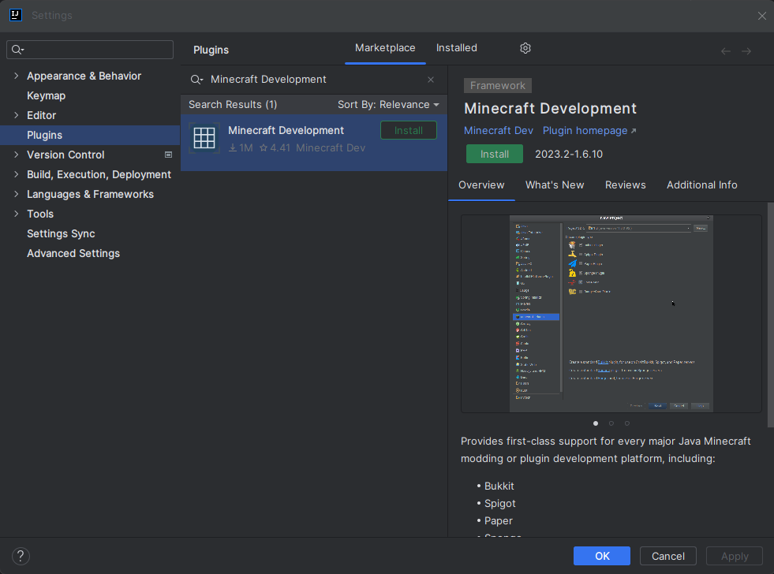
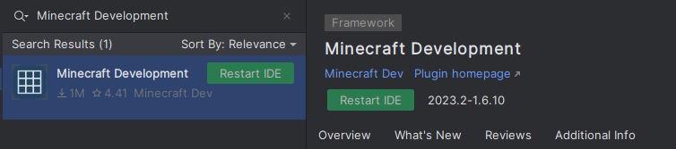
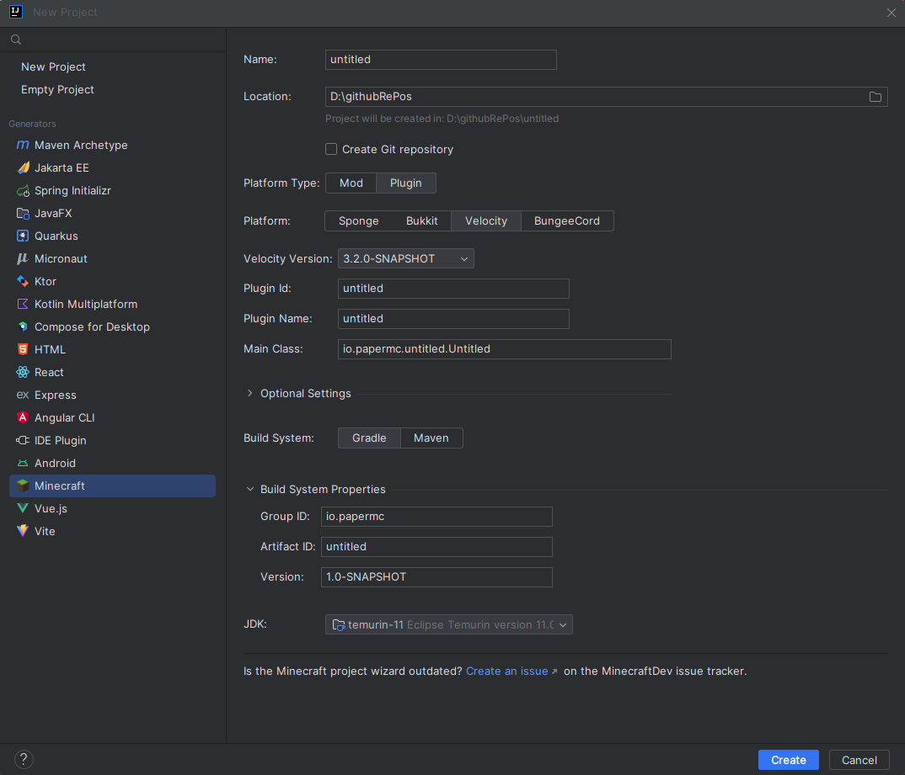
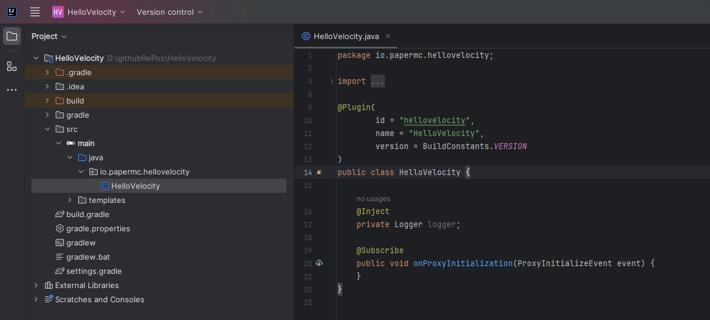

import { Tabs, TabItem } from "@astrojs/starlight/components";
import { LATEST_VELOCITY_RELEASE } from "/src/utils/versions";

Crear un plugin para Velocity es muy sencillo. En esta sección aprenderás a configurar tu
IDE y los identificadores de tu plugin, y conocerás los conceptos básicos de la API de Velocity.

## Antes de continuar...

Necesitarás conocimientos del lenguaje de programación Java. Si aún no lo conoces, te recomendamos encarecidamente
aprender los fundamentos de Java antes de continuar.

## Configurar el entorno

Necesitarás el [JDK](/es/misc/java-install) y un IDE. Si no tienes uno, recomendamos IntelliJ
IDEA.

## Crear el proyecto en tu IDE

- Abre tu IDE.
- Haz clic en `Create New Project` o la opción equivalente.
- Selecciona `Gradle` o `Maven`.
- Asegúrate de que **Project JDK** sea Java 25 o posterior.
- Haz clic en **Finish** para cerrar el cuadro de diálogo y abrir el proyecto.

Ahora que hemos creado el proyecto, debemos configurar el sistema de compilación.

## Ya sé hacerlo: muéstrame lo esencial

### Repositorio de Maven

| Nombre    | URL                                                |
|-----------|----------------------------------------------------|
| `papermc` | `https://repo.papermc.io/repository/maven-public/` |

### Dependencia

| ID de grupo           | ID del artefacto | Versión                   |
|-----------------------|----------------|---------------------------|
| `com.velocitypowered` | `velocity-api` | {LATEST_VELOCITY_RELEASE} |

### Documentación de Javadoc

La documentación de Javadoc está disponible en [jd.papermc.io](jd:velocity).

## Configurar el sistema de compilación

Debes configurar un sistema de compilación antes de continuar. Aunque es posible escribir plugins de Velocity
sin uno, disponer de un sistema de compilación te facilitará mucho el trabajo.

La configuración de un sistema de compilación queda fuera del alcance de esta página, pero puedes consultar la documentación de
([Gradle](https://docs.gradle.org/current/userguide/userguide.html) o
[Maven](https://maven.apache.org/guides/getting-started/index.html)) para obtener ayuda.

:::note[velocity-plugin.json]

Antes de configurar el sistema de compilación, piensa si quieres que `velocity-plugin.json`
se genere automáticamente mediante una anotación `@Plugin` en el código fuente o si prefieres escribirlo
manualmente. Según la opción que elijas, quizá debas añadir líneas adicionales a los archivos de compilación. Puedes encontrar
más información sobre `velocity-plugin.json` [aquí](/es/velocity/dev/velocity-plugin-json).

:::

### Configurar la dependencia

<Tabs syncKey="build-system">
  <TabItem label="Gradle (Kotlin)">
    ```kotlin title="build.gradle.kts" replace
    repositories {
      maven(url = "https://repo.papermc.io/repository/maven-public/") {
        name = "papermc"
      }
    }

    dependencies {
      compileOnly("com.velocitypowered:velocity-api:\{LATEST_VELOCITY_RELEASE}")
      // Si quieres generar velocity-plugin.json a partir de las anotaciones del plugin
      annotationProcessor("com.velocitypowered:velocity-api:\{LATEST_VELOCITY_RELEASE}")
    }
    ```
  </TabItem>
  <TabItem label="Gradle (Groovy)">
    ```groovy title="build.gradle" replace
    repositories {
      maven {
        name = 'papermc'
        url = 'https://repo.papermc.io/repository/maven-public/'
      }
    }

    dependencies {
      compileOnly 'com.velocitypowered:velocity-api:\{LATEST_VELOCITY_RELEASE}'
      // Si quieres generar velocity-plugin.json a partir de las anotaciones del plugin
      annotationProcessor 'com.velocitypowered:velocity-api:\{LATEST_VELOCITY_RELEASE}'
    }
    ```
  </TabItem>
  <TabItem label="Maven 4+">
    :::caution

    Si usas JDK 23 o posterior, debes añadir manualmente el procesador de anotaciones a `pom.xml`, como se muestra en el ejemplo.
    Consulta la [documentación de Maven](https://maven.apache.org/plugins/maven-compiler-plugin-4.x/examples/annotation-processor.html) para obtener más información.

    :::

    ```xml title="pom.xml" replace
    <project>
      <repositories>
        <repository>
          <id>papermc</id>
          <url>https://repo.papermc.io/repository/maven-public/</url>
        </repository>
      </repositories>

      <dependencies>
        <dependency>
          <groupId>com.velocitypowered</groupId>
          <artifactId>velocity-api</artifactId>
          <version>\{LATEST_VELOCITY_RELEASE}</version>
          <scope>provided</scope>
        </dependency>
        <!-- Añade el procesador de anotaciones si quieres generar velocity-plugin.json -->
        <dependency>
          <groupId>com.velocitypowered</groupId>
          <artifactId>velocity-api</artifactId>
          <version>\{LATEST_VELOCITY_RELEASE}</version>
          <type>processor</type>
        </dependency>
      </dependencies>
    </project>
    ```
  </TabItem>
  <TabItem label="Maven 3">
    :::caution

    Si usas JDK 23 o posterior, debes añadir manualmente el procesador de anotaciones a `pom.xml`, como se muestra en el ejemplo.
    Consulta la [documentación de Maven](https://maven.apache.org/plugins/maven-compiler-plugin-4.x/examples/annotation-processor.html) para obtener más información.

    :::

    ```xml title="pom.xml" replace
    <project>
      <repositories>
        <repository>
          <id>papermc</id>
          <url>https://repo.papermc.io/repository/maven-public/</url>
        </repository>
      </repositories>

      <dependencies>
        <dependency>
          <groupId>com.velocitypowered</groupId>
          <artifactId>velocity-api</artifactId>
          <version>\{LATEST_VELOCITY_RELEASE}</version>
          <scope>provided</scope>
        </dependency>
      </dependencies>

      <build>
        <plugins>
          <plugin>
            <groupId>org.apache.maven.plugins</groupId>
            <artifactId>maven-compiler-plugin</artifactId>
            <configuration>
              <!-- Añade el procesador de anotaciones si quieres generar velocity-plugin.json -->
              <annotationProcessorPaths>
                <path>
                  <groupId>com.velocitypowered</groupId>
                  <artifactId>velocity-api</artifactId>
                  <version>\{LATEST_VELOCITY_RELEASE}</version>
                </path>
              </annotationProcessorPaths>
            </configuration>
          </plugin>
        </plugins>
      </build>
    </project>
    ```
  </TabItem>
</Tabs>

## Usar el plugin Minecraft Development para IntelliJ

También puedes usar el [plugin Minecraft Development para IntelliJ](https://plugins.jetbrains.com/plugin/8327-minecraft-development)
para crear un proyecto nuevo. Para ello, primero debes instalar el plugin.

:::note

Este tutorial solo funciona con IntelliJ IDEA. Si usas otro IDE, sigue la guía de configuración manual del proyecto indicada anteriormente.

:::

### Instalar el plugin Minecraft Development

Lo primero que debes hacer es instalar el plugin [Minecraft Development](https://plugins.jetbrains.com/plugin/8327-minecraft-development).
Para ello, ve a `File > Settings > Plugins` y busca `Minecraft Development` en la sección `Marketplace`.



Una vez instalado el plugin, tendrás que reiniciar IntelliJ.
Para ello, haz clic en el botón `Restart IDE` que aparece después de instalarlo.



### Crear un proyecto nuevo

Una vez instalado el plugin, puedes crear un proyecto nuevo desde `File > New > Project...` y seleccionar `Minecraft` en la lista de opciones.

### Configurar un proyecto de Velocity



Se te pedirá que proporciones algunos datos del proyecto.

| Campo                | Descripción                                                                                                                                                                                                                                                               |
|----------------------|---------------------------------------------------------------------------------------------------------------------------------------------------------------------------------------------------------------------------------------------------------------------------|
| **Nombre (`Name`)** | El nombre del proyecto. |
| **Ubicación (`Location`)** | La ubicación del proyecto, donde se guardarán sus archivos. |
| **Tipo de plataforma (`Platform Type`)** | El tipo de plataforma para la que desarrollas. Debe ser `Plugin`. |
| **Plataforma (`Platform`)** | La plataforma para la que desarrollas. Debe ser `Velocity`. |
| **Versión de Velocity (`Velocity Version`)** | La versión de Velocity para la que desarrollas. |
| **ID del plugin (`Plugin Id`)** | El ID del plugin. |
| **Nombre del plugin (`Plugin Name`)** | El nombre del plugin. |
| **Clase principal (`Main Class`)** | La clase principal del plugin, que debe tener la anotación `@Plugin`. |
| **Ajustes opcionales (`Optional Setting`)** | Aquí puedes definir datos como autores, sitio web y descripción. Son opcionales y no hacen falta para que funcione el plugin. |
| **Sistema de compilación (`Build System`)** | El sistema de compilación que quieres usar. Paper recomienda Gradle, pero también puedes usar Maven. |
| **ID de grupo (`Group ID`)** | El ID de grupo del proyecto, que se usa en Maven y Gradle. Suele ser tu nombre de dominio invertido. Si no sabes qué poner, puedes usar algo como `io.github.<tunombre>` o, si no tienes GitHub, `me.<tunombre>`. |
| **ID del artefacto (`Artifact ID`)** | El ID del artefacto del proyecto, que se usa en Maven y Gradle. Suele coincidir con el nombre del proyecto y con el campo `Name`. |
| **Versión (`Version`)** | La versión del proyecto, usada en Maven y Gradle. Normalmente será `1.0-SNAPSHOT`; por ahora no es demasiado importante. |
| **JDK** | El JDK que quieres usar. Puede ser Java 25 o posterior. |

Ahora puedes hacer clic en el botón `Create` para que IntelliJ cree el proyecto.
Si todo salió bien, verás algo parecido a esto:



## Conclusión

Ahora deberías tener un proyecto configurado con Velocity como dependencia.
Solo queda compilar el plugin y ejecutarlo en un servidor Velocity.

:::note

Si quieres simplificar las pruebas de un plugin, puedes usar el plugin de Gradle [Run-Task](https://github.com/jpenilla/run-task).
Descargará automáticamente un servidor Velocity y lo ejecutará por ti.

:::

:::note

Si usas IntelliJ, puedes compilar el plugin desde el menú `Build` de la interfaz de Gradle, en la parte superior derecha del IDE.
El JAR generado estará en el directorio `build/libs`.

:::
